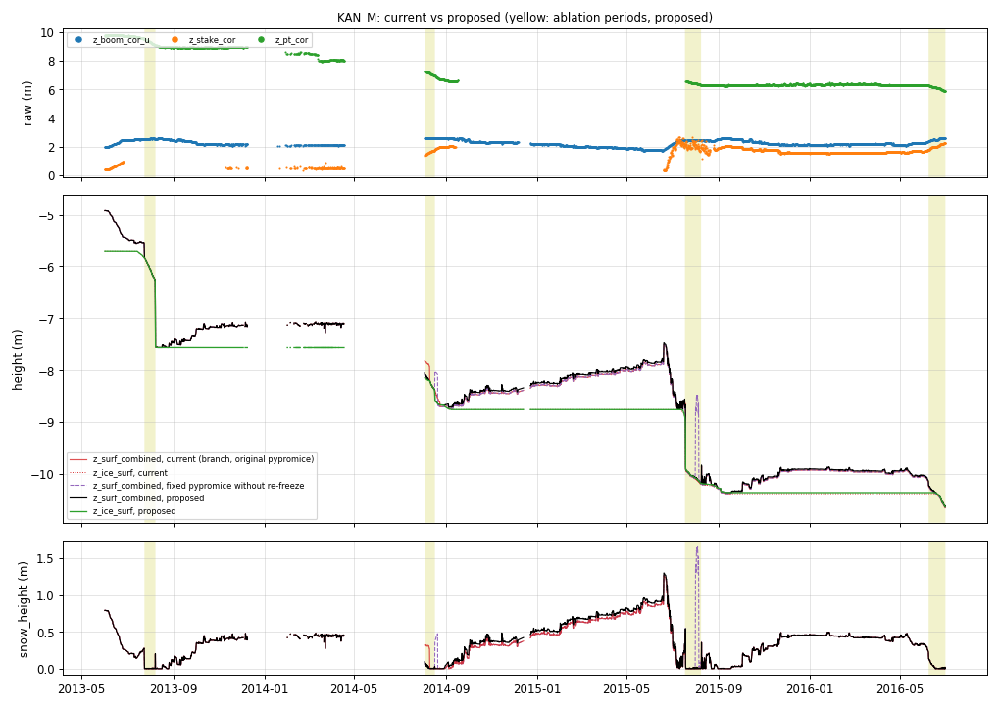
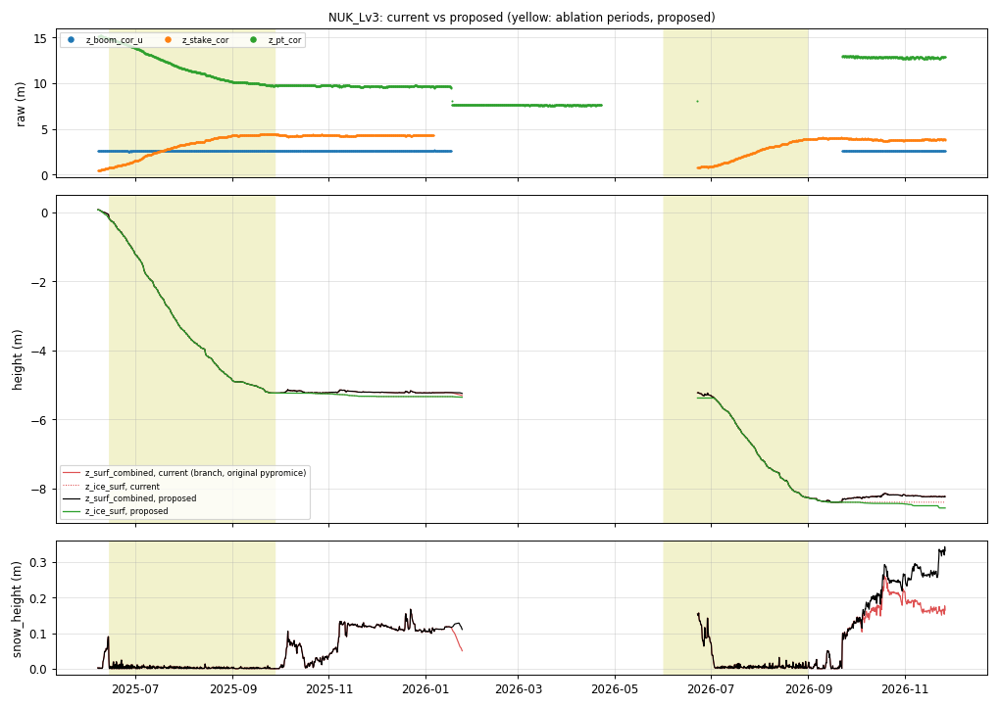
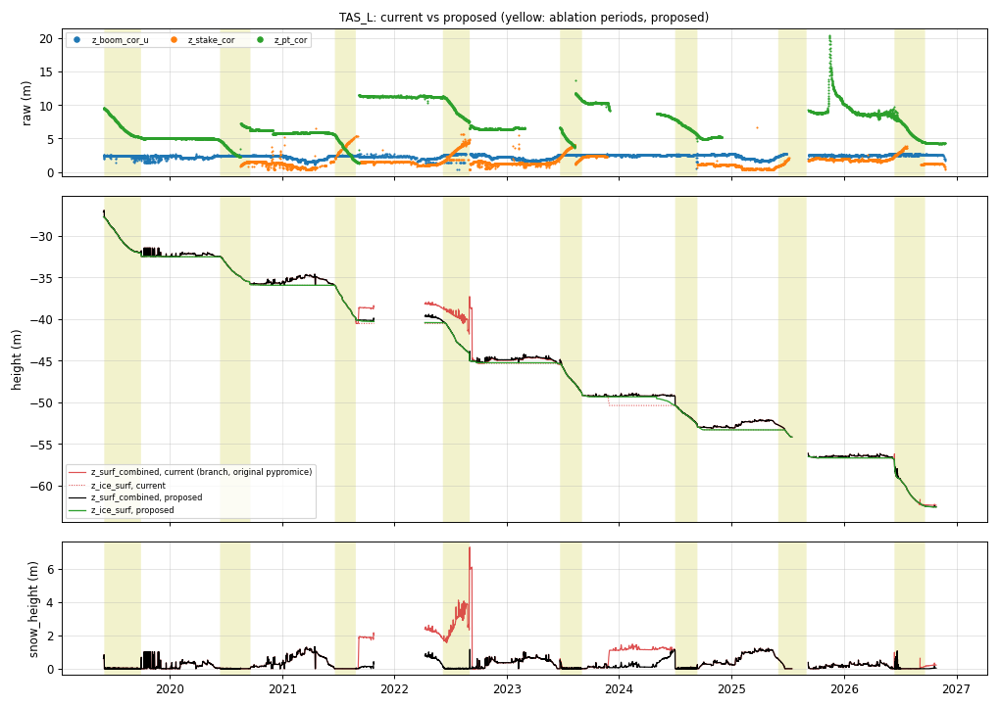
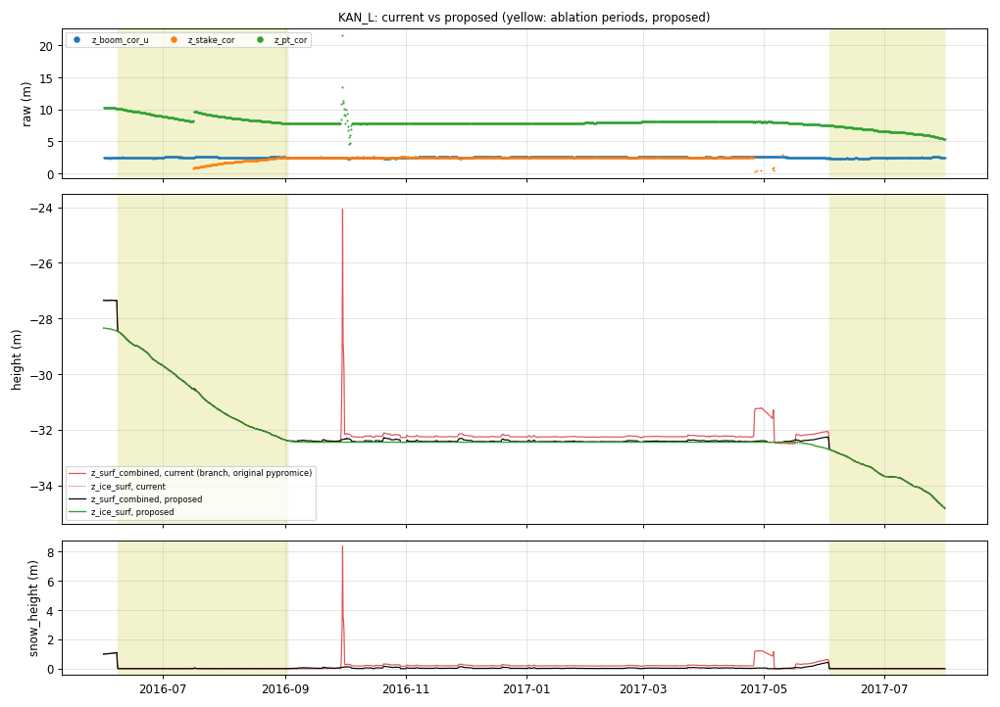
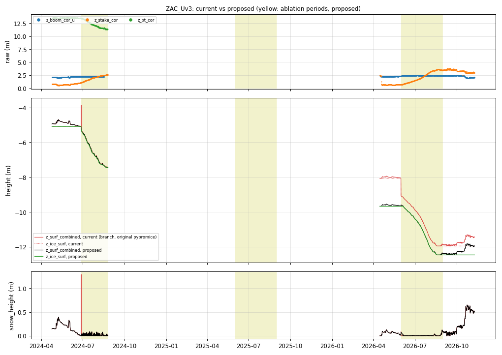
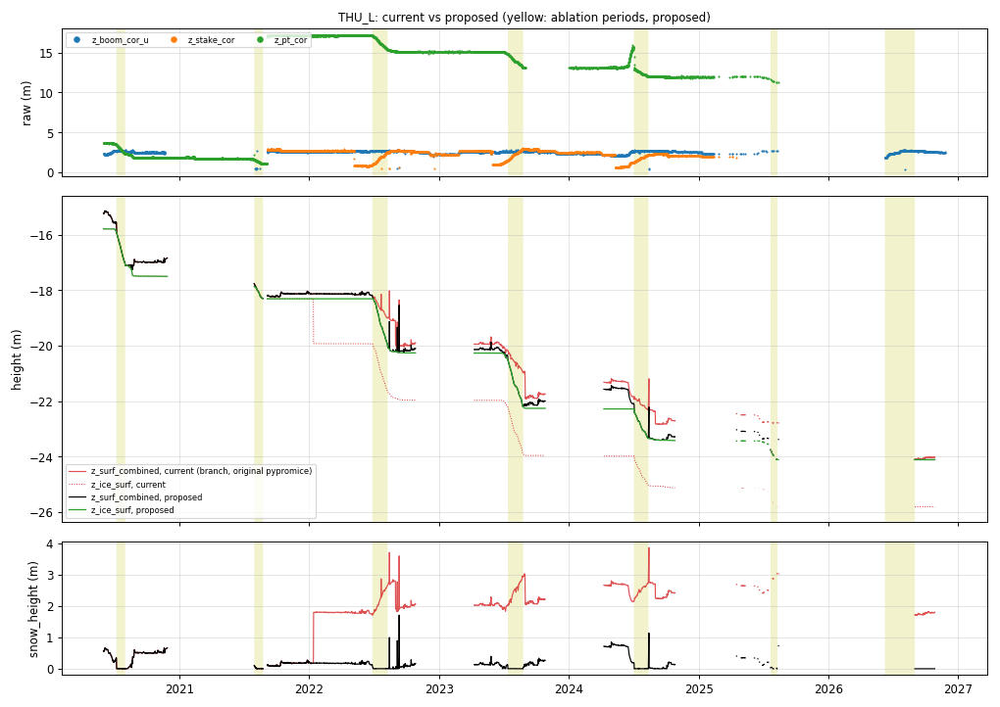
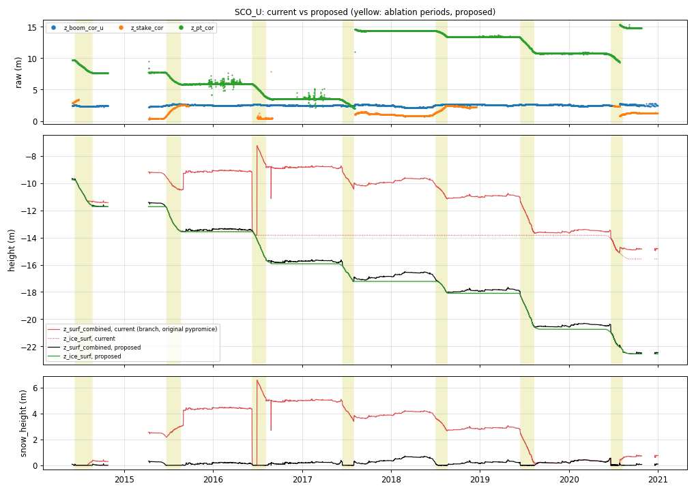

# Surface height review: `stabilizing-surface-height-adjustment` branch

Review of 2026-11-26, PROMICE-AWS-data-issues branch `stabilizing-surface-height-adjustment` (all stations frozen up to ~2026-11-18), pypromice b72a9cb + the `find_ablation_periods` fix.
41 stations scanned: all `_L`, `_M`, `_U`, `_A` stations, their `v3`/`2` successors, plus NUK_K.
Nothing from this review is committed in PROMICE-AWS-data-issues or in this repository.

## TL;DR

1. **pypromice bug in `find_ablation_periods`** (fix committed as `bc1e7a8` on pypromice `bav-dev/surface-height-again`): the spurious-step removal used `z.diff()` on an hourly grid. Whenever the pressure transducer (PT) is not sampled every hour, e.g. 6-hourly transmissions or simply a missing hour, every difference is NaN, gets replaced by 0, and the ablation season is flattened away. 2023 was lost at NUK_K and NUK_L; the detection differs in 1–7 years at 30 of the 39 ablation stations.
   Fix: `dz = z.dropna().diff().reindex(z.index)`.
2. **The fix alone is not enough at frozen stations, and it can make them worse.** The frozen `add` rows were computed with the old ablation periods, but the periods are recomputed at every run, and they decide hour by hour whether `z_surf_combined` comes from `z_ice_surf` or from the sonic rangers. Example: at KAN_M the fix alone increases max snow_height from 1.40 m to 1.77 m and the steps from 4 to 8. At SCO_Lv3 it creates a 5 m spike.
   → Ship the fix together with a **re-freeze**: remove the automated rows from the first year whose detection changes, re-run, and freeze again.
3. **Most of the large errors come from maintenance that has no matching manual shift.** Freezing the automated alignment made these errors permanent:
   - **PT re-installations** with no `z_ice_surf` shift: KAN_Lv3, NUK_Lv3, QAS_Uv3, QAS_U and QAS_L. At KPC_Lv3 the shift is dated 10 days too late.
   - **Stake re-drills** with no `z_surf_2` shift: NUK_L 2020–22 and TAS_L 2021–23. The end-of-ablation alignment then averages a window that straddles the jump.
   - **Erratic PT readings** at installation, at melt-out or while freezing in: KAN_L, QAS_L, UPE_L, THU_L, TAS_L and NUK_K.
   - **Data gaps that span a melt season**, after which the level is arbitrary: NUK_K 2024, THU_L2 2025–26 and ZAC_Uv3 2024–26.
   - **Wrong manual rows**: THU_L `2022-01-13 z_ice_surf −1.7` has no jump in the raw data.
   - **Wrong alignment after a winter gap**: SCO_U 2015–2019, with 4–5 m of phantom snow for four years.
4. **Adjustment files updated for 30 stations** (28 from the scan plus NUK_K and NUK_L) in `PROMICE-AWS-data-issues/adjustments/`, branch `stabilizing-surface-height-adjustment`. Each file is the previous data-issues file plus the new rows, with the automated rows re-frozen using the fixed pypromice. All 28 scanned files reproduce (0 new automated shifts).

### Answer to the question: does the fix change anything in the "frozen" era?

Partly. Your reasoning is right for the **shifts**: the frozen rows were computed while 2023 had "no ablation", so the fix doesn't correct them. With the fix but the old rows, NUK_L ends 2023 with the sonic rangers 6 m above the ice, and NUK_K's max snow_height rises to 3.3 m. But the fix still **changes the output**, because which series is used in each hour comes from the ablation detection, and that runs at every run. A frozen station therefore needs the fix *and* a re-freeze of its rows after the affected period. That is what the proposed files contain.

## Method

The scan runs from the diagnostic repo. Scripts are in the session scratchpad (`scan.py`, `diag.py`, `detect.py`, `maint.py`, `propose.py`, `refreeze.py`, `compare.py`); they can be moved into `lib/` if useful.

1. Fresh L2 for each station (`lib.run_L2` + `join_L2`, current flags) in `data/L2_test/`.
2. `process_surface_height` with the branch's adjustment files, run with the original and with the fixed ablation detection.
3. Metrics: max `snow_height`; hourly steps > 0.5 m in `z_surf_combined`; years where the detection differs; years with sparse PT data; `z_surf_combined − z_ice_surf` after each ablation season; persistent jumps in the raw sensors (> 0.8 m) that have no `add` row within ±3 days.
4. Every fix was tested in a copy of the adjustment folder: automated rows removed from a reset date, new rows added, re-run, frozen, then re-run again to check reproduction.

Overview figures for all stations are in [`figures/scan/`](figures/scan/) (`<station>_overview.png`). Before/after figures are `<station>_proposed.png`.

## Station summary

`current` = branch as committed with the original pypromice (what production gives today); `proposed` = fixed pypromice + proposed file, run in frozen mode. Steps = hours with |Δ z_surf_combined| > 0.5 m.

| station | max snow_height current → proposed (m) | steps current → proposed | z_ice_surf at end current → proposed (m) | action |
|---|---|---|---|---|
| KAN_L | **12.47 → 1.11** | 29 → 5 | −62.5 → −62.5 | new rows + re-freeze from 2016 |
| KAN_Lv3 | 2.48 → 1.08 | 2 → 1 | −8.2 → −8.3 | new row + re-freeze from 2025-08 |
| KAN_M | 1.40 → 1.78 | 4 → 6 | −18.5 → −18.7 | re-freeze from 2014 (see caveat) |
| KAN_U (acc.) | 7.96 (accumulation) | 57 | – | none (spikes 2012–14, 2022-12) |
| KPC_L | **3.20 → 1.49** | 5 → 5 | −36.2 → −36.2 | re-freeze from 2016 |
| KPC_Lv3 | **3.83 → 0.47** (fix only) | 4 → 0 | −4.0 → −4.0 | new row + re-freeze from 2026-06 |
| KPC_U, KPC_Uv3 | 1.32, 0.93 | 0, 0 | | none |
| LYN_L | 2.21 | 23 | 0.12 | none possible (see notes) |
| NUK_K | 2.87 → 2.50 | 19 → 10 | **−21.9 → −23.9** | applied |
| NUK_L | **7.15 → 2.05** | 14 → 13 | −91.0 → −91.0 | applied |
| NUK_Lv3 | **8.47 → 0.37** (fix only) | 1 → 0 | −8.4 → −8.6 | new rows + re-freeze from 2026-06 |
| NUK_U | 1.50 → 1.55 | 3 → 4 | −23.9 → −23.9 | re-freeze from 2011 |
| NUK_Uv3 | 1.18 → 1.18 | 0 → 0 | | re-freeze from 2023 |
| QAS_A, QAS_Lv3 | 2.51, 2.02 | 0, 0 | | none |
| QAS_L | **7.92 → 2.64** | 40 → 38 | **−94.3 → −96.9** | new rows + re-freeze from 2008 |
| QAS_M | 3.27 → 3.27 | 29 → 29 | | re-freeze from 2016 (stake noise left) |
| QAS_Mv3 | 2.38 → 2.38 | 6 → 5 | | re-freeze from 2024 |
| QAS_U | 4.24 → 3.30 | 34 → 33 | | new row + re-freeze from 2011 |
| QAS_Uv3 | 4.34 → 4.34 (7.5 with fix only) | 11 → 11 | −8.0 → −8.5 | new row + re-freeze from 2026 |
| RED_Lv3 | 0.45 | 0 | | none |
| SCO_L | 1.47 → 1.47 (3.3 with fix only) | 2 → 2 | | re-freeze from 2012 |
| SCO_Lv3 | 0.99 → 0.99 (5.1 with fix only) | 0 → 0 | | re-freeze from 2026 |
| SCO_U | **6.61 → 1.10** | 6 → 4 | **−23.2 → −30.8** | re-freeze from 2010 |
| SCO_Uv3 | 0.84 → 0.70 | 0 | | re-freeze from 2025 |
| TAS_A | 2.46 → 2.46 | 0 | | re-freeze from 2015 |
| TAS_Av3 | 1.48 | 1 | | none |
| TAS_L | **7.31 → 4.54** (≤1.2 after 2019) | 124 → 113 | −62.7 → −62.7 | new rows + re-freeze from 2021 |
| TAS_U | 2.44 → 2.28 | 16 → 16 | | re-freeze from 2008 |
| THU_L | 3.89 → 2.19 | 5 → 5 | −25.8 → −24.1 | **remove a manual row**, new row, re-freeze from 2013 |
| THU_L2 | **6.32 → 1.37** | 33 → 30 | −8.1 → −9.9 | new rows + re-freeze from 2022 |
| THU_U | 2.45 → 2.21 | 13 → 13 | | re-freeze from 2016 |
| THU_U2, THU_U2v3 | 1.90, 2.07 | 0, 1 | | none |
| UPE_L | 3.25 → 2.90 (12.2 with fix only) | 4 → 4 | | new row + re-freeze from 2015 |
| UPE_U | 2.56 → 1.23 | 1 → 0 | | re-freeze from 2011 |
| WEG_L | 1.37 | 1 | | re-freeze from 2026 |
| ZAC_A (acc.) | 2.98 | 13 | | none |
| ZAC_Lv3 | 0.85 → 0.50 | 1 → 0 | | re-freeze from 2024 |
| ZAC_Uv3 | **8.44 → 0.69** | 3 → 0 | −12.0 → −12.5 | new rows + re-freeze from 2024-06 |

The remaining steps are mostly (i) sonic-ranger noise, e.g. TAS_L before 2019, QAS_L 2008 and LYN_L since 2025, and (ii) the step at the onset of ablation (see *pypromice follow-ups*).

## Findings and suggestions

### 1. Re-freeze after the pypromice fix

The dashed purple line is the fix without re-freeze: new 1–1.5 m spikes at the ends of the 2014 and 2015 ablation seasons, where the frozen shift dates no longer match the detected end. The re-freeze (black) removes them.
At SCO_Lv3 (2026) the fix alone gives a 5 m spike for two weeks, and re-freezing removes it ([figure](figures/scan/SCO_Lv3_proposed.png)).

**Caveat (KAN_M, and in short windows at SCO_U 2010-08, QAS_U 2022-07/08 and THU_L).** Once the re-frozen rows are applied as `add` rows, the result differs locally from the dynamic run, by up to 1.8 m at KAN_M in 2015-08. Each case has a frozen `z_ice_surf … to z_surf_2 at start of ablation` row of 1.2–1.5 m. When frozen, that step is in the input of the ablation detection; in dynamic mode, the detection runs before the shift. Frozen and dynamic modes are therefore not strictly equivalent (see follow-ups). For KAN_M the frozen re-freeze (1.78 m / 6 steps) is about as good as the fix alone (1.77 m / 8), and slightly worse than today (1.40 m / 4).

### 2. Pressure transducer re-installed without a `z_ice_surf` shift

The readme says `z_ice_surf` is "adjusted manually every time there is maintenance". For recent installations, these rows are missing. The new PT starts at an arbitrary level, and as soon as the ablation season starts, `z_surf_combined` jumps to it.

| station | proposed rows |
|---|---|
| KAN_Lv3 | `2025-08-25T15:00 z_ice_surf add −2.51` (PT re-installed during the 2025 ablation season: the 2026 ablation started 2.5 m above the surface) — [figure](figures/scan/KAN_Lv3_proposed.png) |
| NUK_Lv3 | `2026-09-22T14:00 z_ice_surf add −8.25` (+8.3 m for 10 days); `2026-06-01→07-01 z_ice_surf max_filter −999` (PT readings rising: not anchored) |
| QAS_Uv3 | `2026-08-29 z_ice_surf add −7.38` (+7.4 m for a week) — [figure](figures/scan/QAS_Uv3_proposed.png) |
| KPC_Lv3 | `2026-05-16T18:00 z_ice_surf add −3.8658`: the frozen row has the right value but is dated 2026-06-10 (first `z_surf_2` sample in the ablation season), so the first 10 days are 3.8 m off — [figure](figures/scan/KPC_Lv3_proposed.png) |
| QAS_U | `2021-10-01 z_ice_surf add +1.15`: the new PT was anchored 1.15 m below the end-of-summer surface, giving 4 m of snow in winter 2021–22 — [figure](figures/scan/QAS_U_proposed.png) |

### 3. Stake re-drilled without a `z_surf_2` shift (NUK_L, TAS_L)

The automated alignment at the end of the ablation season compares `z_surf_2` with `z_ice_surf` over [t_end − 7 d, t_end + 30 d]. If the stake is re-drilled inside that window, the mean mixes the levels before and after the re-drill, leaving an offset that frozen rows keep forever: 0.9, 1.2 and 3 m at NUK_L, and a 7 m spike plus 2 m of phantom snow at TAS_L.
Proposed: a `z_surf_2 add` at each re-drill (values from the raw jump):

- TAS_L: `2021-09-07T12 −3.93`, `2022-09-01T12 −4.11`, `2023-08-10T19 −2.91`
- NUK_L ([figure](figures/NUK_L_branch_vs_proposed.png)): `2020-08-29T06 −3.58`, `2021-08-27T18 −4.50`, `2022-08-19T18 −4.50`

TAS_L also has its PT dropping 1.2 m in winter 2023–24 (`2023-11-20→2024-04-30 z_ice_surf max_filter −999`). The new PT of 2025 is still freezing in (`2025-09-01→2026-06-01 max_filter −999`).

### 4. Erratic PT readings

These produce spikes and, through the running minimum of `z_ice_surf`, months of phantom snow.

| station | proposed rows |
|---|---|
| KAN_L | `2016-09-28→10-08 z_ice_surf max_filter −999` (re-installation, 8 m spike, 12.5 m snow); `2017-04-26→06-01 z_surf_2 max_filter −999` (noisy stake after re-drill). Needs a re-freeze from 2016: removing the readings moves the detected 2016 end of ablation by 4 weeks |
| QAS_L | `2008-07-16→08-07 z_ice_surf max_filter −999` (PT melted out, depth < 0.5 m); `2008-08-07 z_ice_surf add −2.6` (new PT was 2 m above the old one during melt; 15 days × 4 cm/day); `2009-06-01→07-29 max_filter −999` (shallow PT, then three re-installations); `2010-05-27→06-01 max_filter −999`. Result: 1.5–2 m less snow in winter 2008–09 and 2.6 m more ice loss — [figure](figures/scan/QAS_L_proposed.png) |
| UPE_L | `2026-09-10→09-19 z_ice_surf max_filter −999` (readings up to 17 m: a 12 m spike once the fix is in) — [figure](figures/scan/UPE_L_proposed.png) |
| THU_L | `2024-06-13→07-03 z_ice_surf max_filter −999` |
| NUK_K | 2019-09 re-installation (figure: [NUK_K](figures/NUK_K_branch_vs_proposed.png)) |

### 5. Data gaps across the melt season

All sensors stop, and when they restart the level is not constrained. Following the readme, the level after the gap is set from the mean annual ablation of the station. **These values are assumptions, not observations.**

- **ZAC_Uv3** (gap 2024-09 → 2026-04): the current level implies only 0.6 m of ablation in 2025, and `z_surf_1`/`z_surf_2` restart 2.2 m apart. `2025-01-01 z_surf_1 add −2.7`, `z_surf_2 add −0.5` (2025 set to the 2.4 m/yr 2022–24 mean). Also `2024-04-01→06-28T06 z_ice_surf max_filter −999` (new PT not aligned until the first ablation hour: +7.6 m spike).
- **THU_L2** (gap 2025-07-28 → 2026-06-08): the restart was *above* the last value. `2026-01-01 z_ice_surf add −1.7`, `z_surf_2 add −1.7`, `z_surf_1 add +3.99` (boom re-installed, set to `z_surf_2`); `2026-06-01→06-09T06 z_ice_surf max_filter −999` — [figure](figures/scan/THU_L2_proposed.png).
- **NUK_K** (gap 2024-01 → 2024-08): −0.9 m on all three series.

### 6. Wrong manual row (THU_L)

`2022-01-13T00:00,,z_ice_surf,add,-1.7,manually adjusted by bav` has no counterpart in the raw `z_pt_cor`, which is flat at 17.13 m across that date. From 2022 on, it gives a −1.7 m step at each ablation onset and 1.8–2.8 m of phantom snow every winter. **Proposed: delete the row** (already deleted in the proposed THU_L file).

### 7. Wrong alignment after a winter gap (SCO_U)

After the 2014–15 winter gap, the stake restarted 4 m above the boom and the PT. The PT was continuous across the gap, but the automated alignment re-anchored `z_ice_surf` and then the sonic rangers to the stake. As a result, `z_surf_combined` was 4–5 m too high from 2015 to 2019, and the error carried on to the end of the record. A re-freeze from 2010 with the fixed detection gives a consistent chain (1.0–2.6 m/yr). The ice surface at the end of the record moves from −23.2 to −30.8 m.

Fixed by re-freeze only, with no new rows: KPC_L (3.2 → 1.5 m, [figure](figures/scan/KPC_L_proposed.png)), UPE_U (2.6 → 1.2 m, [figure](figures/scan/UPE_U_proposed.png)), ZAC_Lv3 and SCO_Uv3.

### Not fixable with adjustment rows

- **LYN_L**: there is no PT, and the sonic rangers saturate at ~2.4 m once ice is exposed, so ice ablation is not recorded and `z_ice_surf` is flat at 0.12 m. Since summer 2025 the rangers return two or three alternating levels (1.6/2.0/2.4 m), which causes ±0.8 m noise. Suggest flagging `z_boom_u` and `z_stake` in summer 2025 and summer 2026, and documenting that LYN_L has no ice-ablation record.
- **QAS_M**: stake noise 2020-12-31 → 2021-01 (+2.7 m jumps) and 2022-09 → 12. Flags in the L2 flag file would remove it.
- **KAN_U** (accumulation): isolated spikes 2012–2014 and 2022-12; sonic rangers diverge by 0.3–0.5 m in 2020–23.
- **QAS_Uv3**: one-sample spike 2025-03-01 (also present today).

## pypromice follow-ups (not done)

1. **Commit the `find_ablation_periods` fix**, together with the re-frozen files. Merging one without the other degrades the stations listed above.
2. **Detection in frozen mode**: run `find_ablation_periods` on `z_ice_surf` before the alignment `add` rows, or neutralise the steps at the dates of those rows. That would make frozen and dynamic modes equivalent (the KAN_M caveat above).
3. **End-of-ablation alignment**: when the stake is re-drilled inside [t_end − 7 d, t_end + 30 d], align using only the samples after the re-drill (detected as a persistent negative jump of `z_stake` > 1 m).
4. **New PT**: when the PT comes back after a gap, align it to `z_surf_2` at its first sample rather than at the first sample of the ablation season (KPC_Lv3, ZAC_Uv3, THU_L2).
5. **Ablation onset**: the season can start before the sonic rangers see the snow disappear (NUK_K 2023-06-01, about 1 m at several stations), which causes a step down at the onset. The start could be bounded by the snow-free date from `z_surf_1`/`z_surf_2`.
6. **Gaps**: the readme rule for gaps (use the general slope) is not automated. It could be, using the station's mean annual ablation.

## How to apply

1. pypromice fix: committed (`bc1e7a8`, branch `bav-dev/surface-height-again`). It must be merged together with the re-frozen adjustment files.
2. The proposed files have been copied into `PROMICE-AWS-data-issues/adjustments/` (branch `stabilizing-surface-height-adjustment`). Each file keeps the existing rows and comments. In each file:
   - a block `# --- proposed (surface height review 2026-11-26) ---` holds the new rows, commented `(review 2026-11)`;
   - a block `# auto-suggested 2026-11-26 after surface height review` holds the re-frozen automated rows;
   - the automated rows after the reset date are removed;
   - `dynamic_adjust_after` sits at the end of the record.
3. NUK_K and NUK_L were edited directly in data-issues; before/after figures: [NUK_K](figures/NUK_K_branch_vs_proposed.png), [NUK_L](figures/NUK_L_branch_vs_proposed.png).
4. The proposed files were produced from data up to 2026-11-26. Stations that received data since then will get automated rows after `dynamic_adjust_after`, as usual.
