# Comparison of data ice to thredds (old).
## CEN
Variables in new file:
p_u, p_l, t_u, t_l, rh_u, rh_u_wrt_ice_or_water, qh_u, rh_l, rh_l_wrt_ice_or_water, qh_l, wspd_u, wspd_l, wdir_u, wdir_l, wspd_x_u, wspd_y_u, wspd_x_l, wspd_y_l, dsr, dsr_cor, usr, usr_cor, albedo, dlr, ulr, cc, t_surf, dlhf_u, dlhf_l, dshf_u, dshf_l, z_boom_u, z_boom_cor_u, z_boom_l, z_boom_cor_l, z_stake, z_stake_cor, z_surf_combined, snow_height, rainfall_u, rainfall_cor_u, rainfall_l, rainfall_cor_l, t_i_1, t_i_2, t_i_3, t_i_4, t_i_5, t_i_6, t_i_7, t_i_8, t_i_9, t_i_10, t_i_11, d_t_i_1, d_t_i_2, d_t_i_3, d_t_i_4, d_t_i_5, d_t_i_6, d_t_i_7, d_t_i_8, d_t_i_9, d_t_i_10, d_t_i_11, t_i_10m, tilt_x, tilt_y, rot_magnetic, rot_true, gps_lat, gps_lon, gps_alt, lat, lon, alt, batt_v, t_rad

New variables not in old files:

Old variables removed from new files:

 
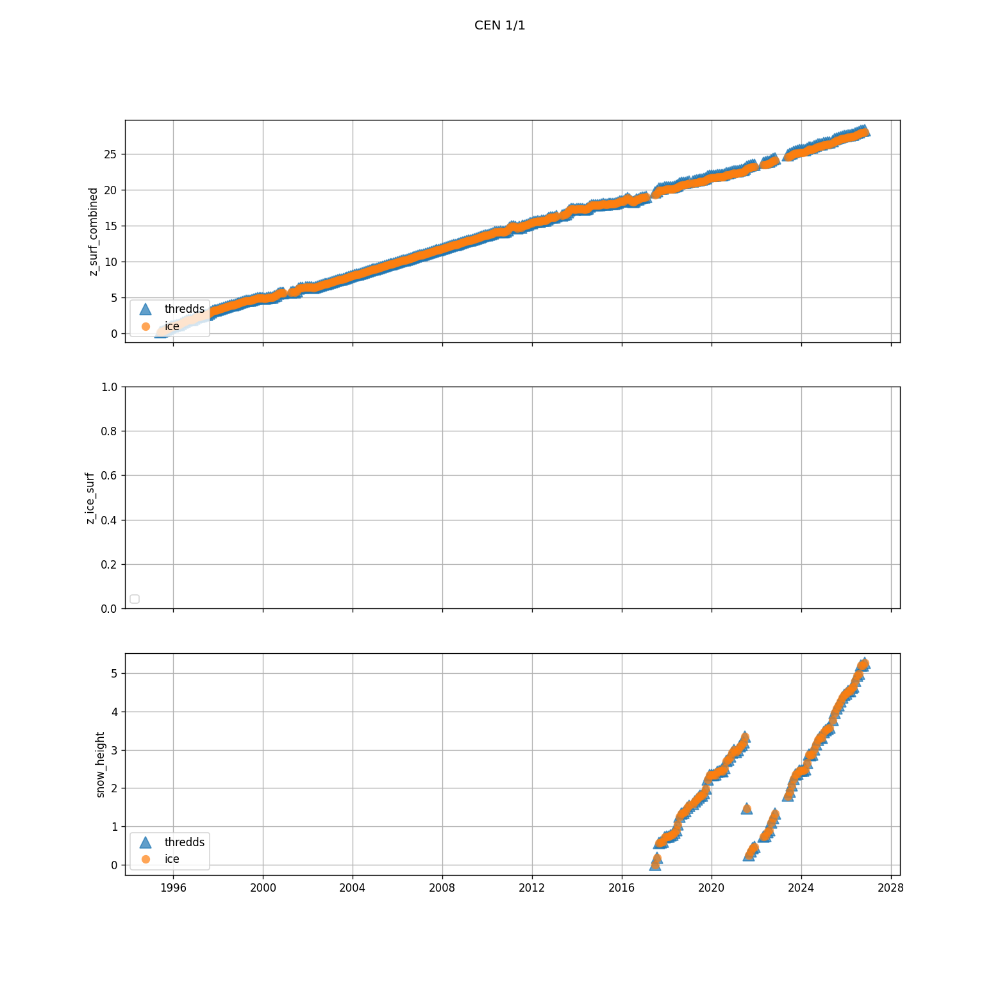
 
## CP1
Variables in new file:
p_u, p_l, t_u, t_l, rh_u, rh_u_wrt_ice_or_water, qh_u, rh_l, rh_l_wrt_ice_or_water, qh_l, wspd_u, wspd_l, wdir_u, wdir_l, wspd_x_u, wspd_y_u, wspd_x_l, wspd_y_l, dsr, dsr_cor, usr, usr_cor, albedo, dlr, ulr, cc, t_surf, dlhf_u, dlhf_l, dshf_u, dshf_l, z_boom_u, z_boom_cor_u, z_boom_l, z_boom_cor_l, z_surf_combined, snow_height, rainfall_u, rainfall_cor_u, rainfall_l, rainfall_cor_l, t_i_1, t_i_2, t_i_3, t_i_4, t_i_5, t_i_6, t_i_7, t_i_8, t_i_9, t_i_10, t_i_11, d_t_i_1, d_t_i_2, d_t_i_3, d_t_i_4, d_t_i_5, d_t_i_6, d_t_i_7, d_t_i_8, d_t_i_9, d_t_i_10, d_t_i_11, t_i_10m, tilt_x, tilt_y, rot_magnetic, rot_true, gps_lat, gps_lon, gps_alt, lat, lon, alt, batt_v, t_rad

New variables not in old files:

Old variables removed from new files:

 
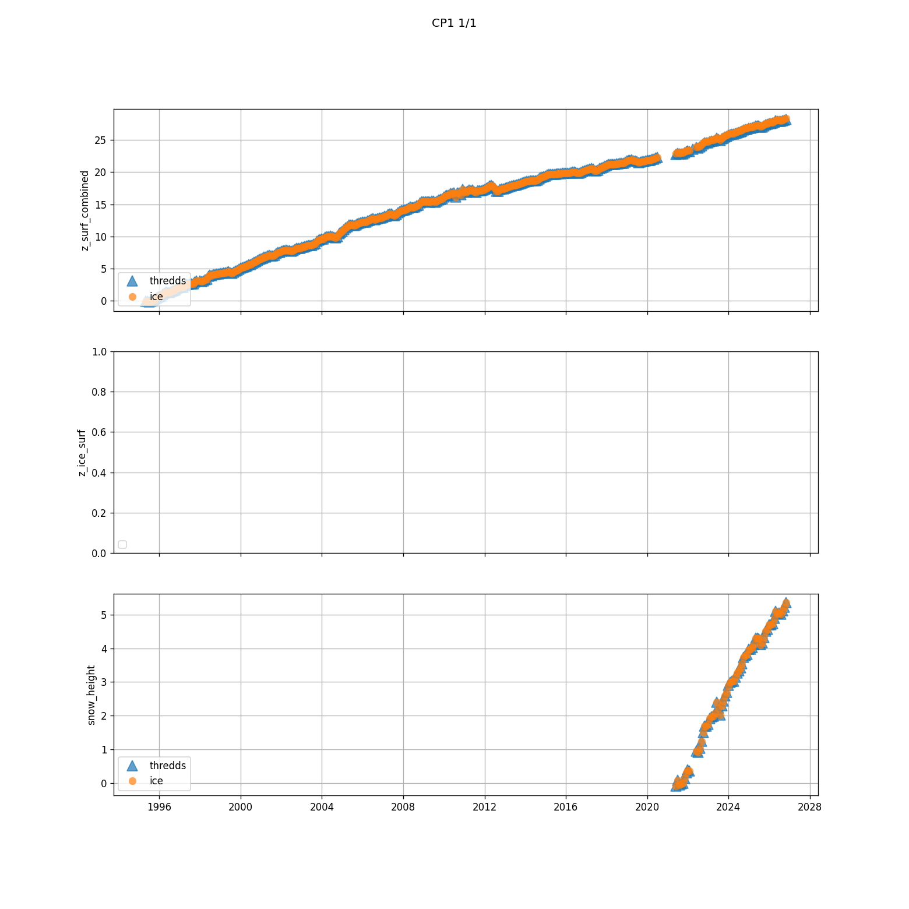
 
## DY2
Variables in new file:
p_u, p_l, t_u, t_l, rh_u, rh_u_wrt_ice_or_water, qh_u, rh_l, rh_l_wrt_ice_or_water, qh_l, wspd_u, wspd_l, wdir_u, wdir_l, wspd_x_u, wspd_y_u, wspd_x_l, wspd_y_l, dsr, dsr_cor, usr, usr_cor, albedo, dlr, ulr, cc, t_surf, dlhf_u, dlhf_l, dshf_u, dshf_l, z_boom_u, z_boom_cor_u, z_boom_l, z_boom_cor_l, z_surf_combined, snow_height, rainfall_u, rainfall_cor_u, rainfall_l, rainfall_cor_l, t_i_1, t_i_2, t_i_3, t_i_4, t_i_5, t_i_6, t_i_7, t_i_8, t_i_9, t_i_10, t_i_11, d_t_i_1, d_t_i_2, d_t_i_3, d_t_i_4, d_t_i_5, d_t_i_6, d_t_i_7, d_t_i_8, d_t_i_9, d_t_i_10, d_t_i_11, t_i_10m, tilt_x, tilt_y, rot_magnetic, rot_true, gps_lat, gps_lon, gps_alt, lat, lon, alt, batt_v, t_rad

New variables not in old files:

Old variables removed from new files:

 
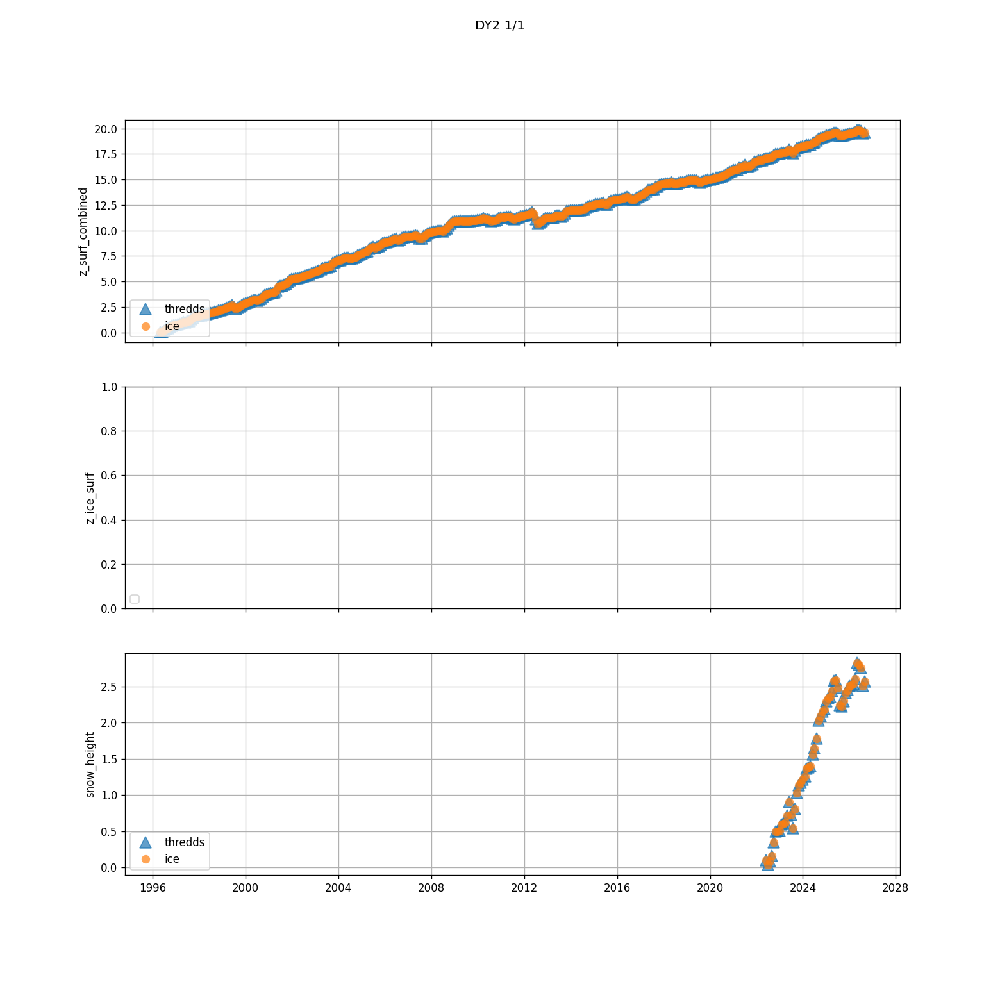
 
## EGP
Variables in new file:
p_u, t_u, t_l, rh_u, rh_u_wrt_ice_or_water, qh_u, rh_l, rh_l_wrt_ice_or_water, qh_l, wspd_u, wspd_l, wdir_u, wdir_l, wspd_x_u, wspd_y_u, wspd_x_l, wspd_y_l, dsr, dsr_cor, usr, usr_cor, albedo, dlr, ulr, cc, t_surf, dlhf_u, dshf_u, z_boom_u, z_boom_cor_u, z_boom_l, z_boom_cor_l, z_stake, z_stake_cor, z_surf_combined, snow_height, rainfall_u, rainfall_cor_u, t_i_1, t_i_2, t_i_3, t_i_4, t_i_5, t_i_6, t_i_7, t_i_8, t_i_9, t_i_10, t_i_11, d_t_i_1, d_t_i_2, d_t_i_3, d_t_i_4, d_t_i_5, d_t_i_6, d_t_i_7, d_t_i_8, d_t_i_9, d_t_i_10, d_t_i_11, t_i_10m, tilt_x, tilt_y, rot_magnetic, rot_true, gps_lat, gps_lon, gps_alt, lat, lon, alt, batt_v, t_rad

New variables not in old files:

Old variables removed from new files:

 
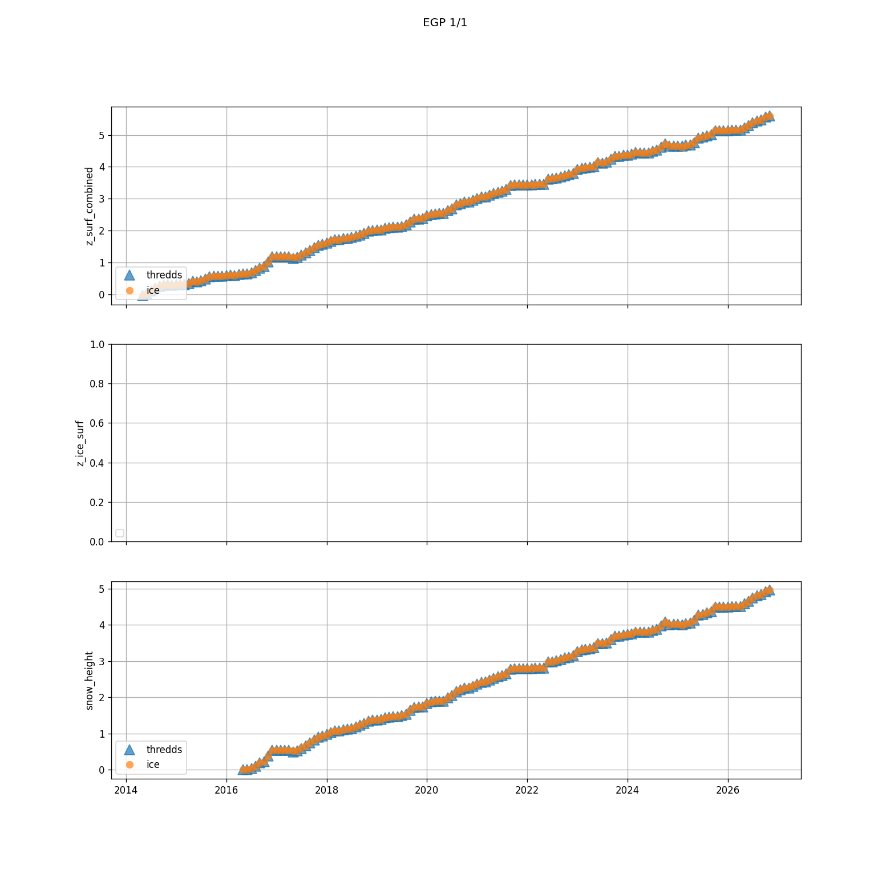
 
## FRE
Variables in new file:
p_u, t_u, rh_u, rh_u_wrt_ice_or_water, qh_u, wspd_u, wdir_u, wspd_x_u, wspd_y_u, dsr, dsr_cor, usr, usr_cor, albedo, dlr, ulr, cc, t_surf, dlhf_u, dshf_u, z_boom_u, z_boom_cor_u, z_stake, z_stake_cor, z_pt, z_pt_cor, z_surf_combined, z_ice_surf, snow_height, t_i_1, t_i_2, t_i_3, t_i_4, t_i_5, t_i_6, t_i_7, t_i_8, d_t_i_1, d_t_i_2, d_t_i_3, d_t_i_4, d_t_i_5, d_t_i_6, d_t_i_7, d_t_i_8, t_i_10m, tilt_x, tilt_y, rot_true, gps_lat, gps_lon, gps_alt, lat, lon, alt, batt_v, t_rad

New variables not in old files:

Old variables removed from new files:

 
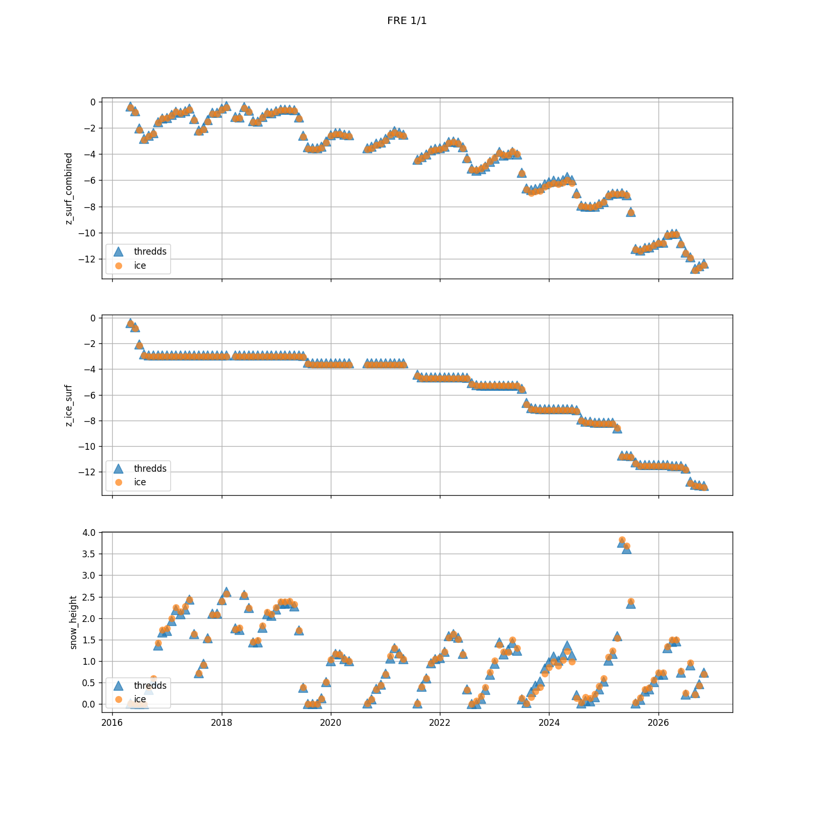
 
## HUM
Variables in new file:
p_u, p_l, t_u, t_l, rh_u, rh_u_wrt_ice_or_water, qh_u, rh_l, rh_l_wrt_ice_or_water, qh_l, wspd_u, wspd_l, wdir_u, wdir_l, wspd_x_u, wspd_y_u, wspd_x_l, wspd_y_l, dsr, dsr_cor, usr, usr_cor, albedo, dlr, ulr, cc, t_surf, dlhf_u, dlhf_l, dshf_u, dshf_l, z_boom_u, z_boom_cor_u, z_boom_l, z_boom_cor_l, z_surf_combined, snow_height, rainfall_u, rainfall_cor_u, rainfall_l, rainfall_cor_l, t_i_1, t_i_2, t_i_3, t_i_4, t_i_5, t_i_6, t_i_7, t_i_8, t_i_9, t_i_10, t_i_11, d_t_i_1, d_t_i_2, d_t_i_3, d_t_i_4, d_t_i_5, d_t_i_6, d_t_i_7, d_t_i_8, d_t_i_9, d_t_i_10, d_t_i_11, t_i_10m, tilt_x, tilt_y, rot_magnetic, rot_true, gps_lat, gps_lon, gps_alt, lat, lon, alt, batt_v, t_rad

New variables not in old files:

Old variables removed from new files:

 
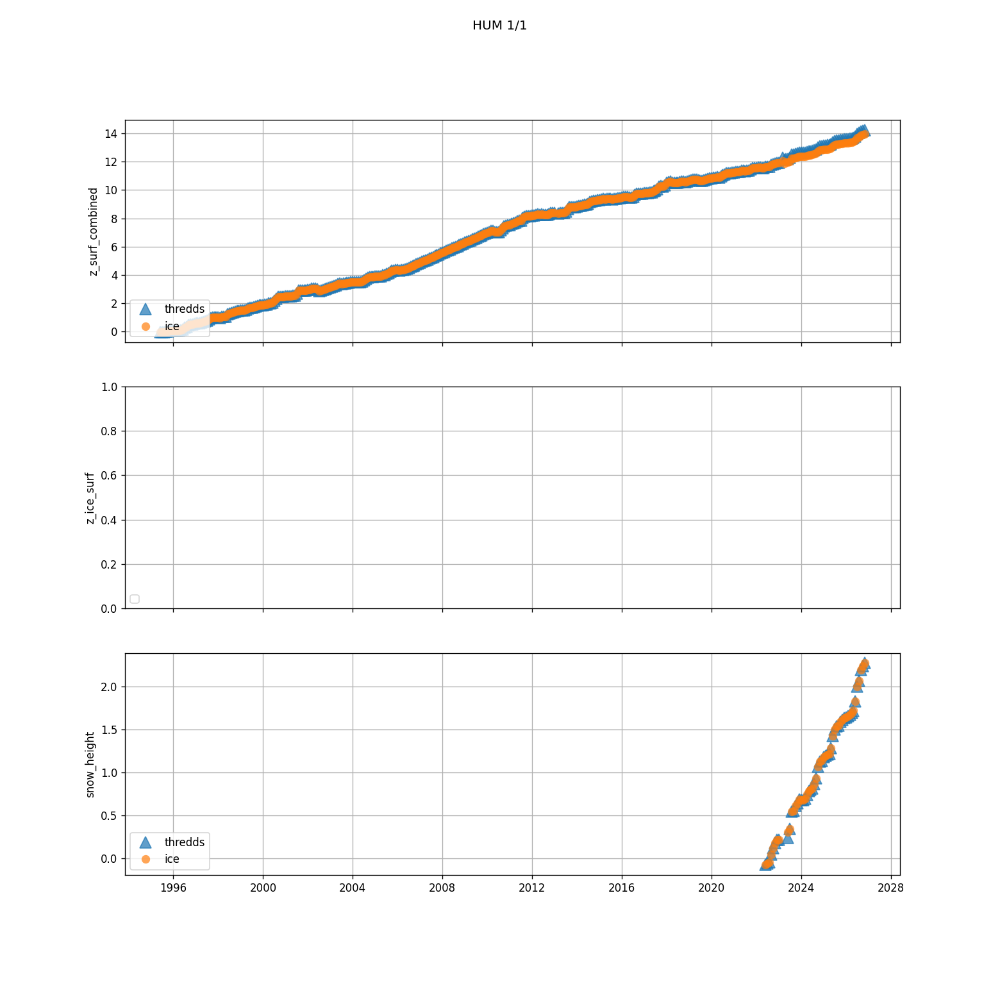
 
## JAR
Variables in new file:
p_u, t_u, t_l, rh_u, rh_u_wrt_ice_or_water, qh_u, rh_l, rh_l_wrt_ice_or_water, qh_l, wspd_u, wspd_l, wdir_u, wdir_l, wspd_x_u, wspd_y_u, wspd_x_l, wspd_y_l, dsr, dsr_cor, usr, usr_cor, albedo, dlr, ulr, cc, t_surf, dlhf_u, dshf_u, z_boom_u, z_boom_cor_u, z_boom_cor_l, z_stake, z_stake_cor, z_pt, z_pt_cor, z_surf_combined, z_ice_surf, snow_height, rainfall_u, rainfall_cor_u, t_i_1, t_i_2, t_i_3, t_i_4, t_i_5, t_i_6, t_i_7, t_i_8, t_i_9, t_i_10, d_t_i_1, d_t_i_2, d_t_i_3, d_t_i_4, d_t_i_5, d_t_i_6, d_t_i_7, d_t_i_8, d_t_i_9, d_t_i_10, t_i_10m, tilt_x, tilt_y, rot_magnetic, rot_true, gps_lat, gps_lon, gps_alt, lat, lon, alt, batt_v, t_rad

New variables not in old files:

Old variables removed from new files:

 
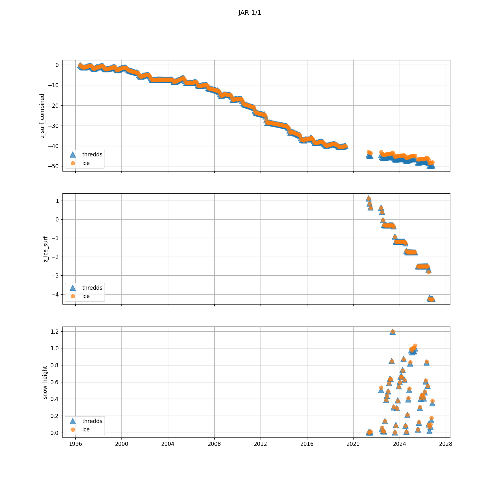
 
## KAN_B
Variables in new file:
p_u, t_u, rh_u, rh_u_wrt_ice_or_water, qh_u, wspd_u, wdir_u, wspd_x_u, wspd_y_u, dsr, usr, albedo, dlr, ulr, t_surf, z_boom_u, z_boom_cor_u, z_surf_combined, snow_height, rot_true, lat, lon, alt, batt_v, t_rad

New variables not in old files:

Old variables removed from new files:

 
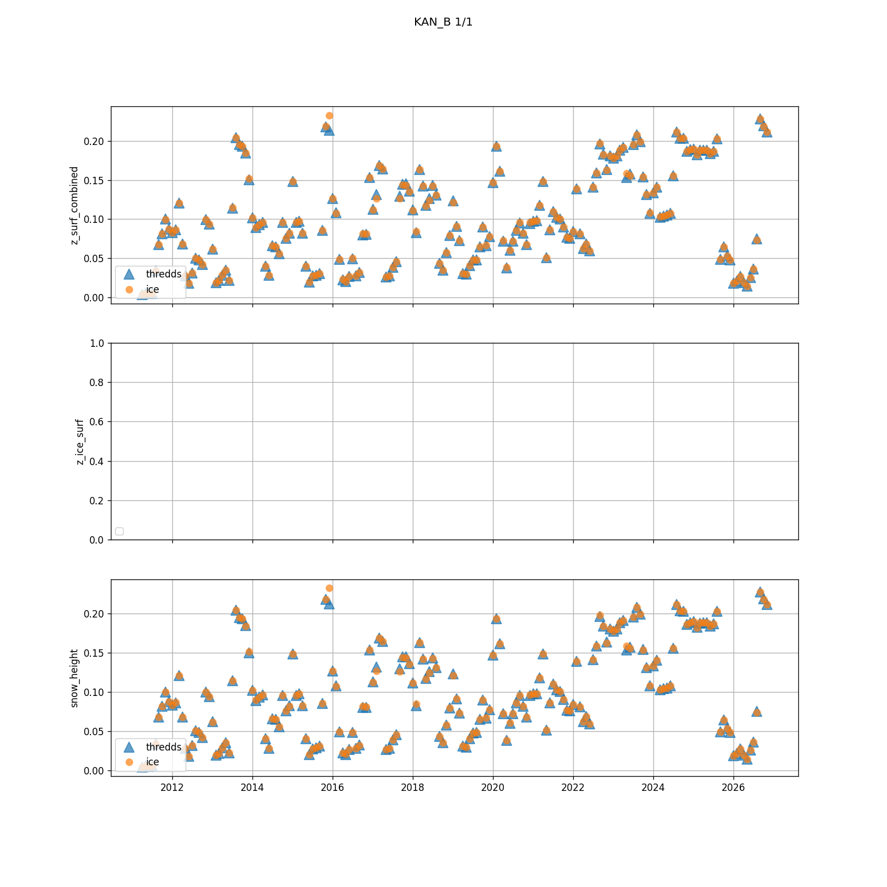
 
## KAN_L
Variables in new file:
p_u, t_u, rh_u, rh_u_wrt_ice_or_water, qh_u, wspd_u, wdir_u, wspd_x_u, wspd_y_u, dsr, dsr_cor, usr, usr_cor, albedo, dlr, ulr, cc, t_surf, dlhf_u, dshf_u, z_boom_u, z_boom_cor_u, z_stake, z_stake_cor, z_pt, z_pt_cor, z_surf_combined, z_ice_surf, snow_height, rainfall_u, rainfall_cor_u, t_i_1, t_i_2, t_i_3, t_i_4, t_i_5, t_i_6, t_i_7, t_i_8, d_t_i_1, d_t_i_2, d_t_i_3, d_t_i_4, d_t_i_5, d_t_i_6, d_t_i_7, d_t_i_8, t_i_10m, tilt_x, tilt_y, rot_magnetic, rot_true, gps_lat, gps_lon, gps_alt, lat, lon, alt, batt_v, t_rad

New variables not in old files:

Old variables removed from new files:

 
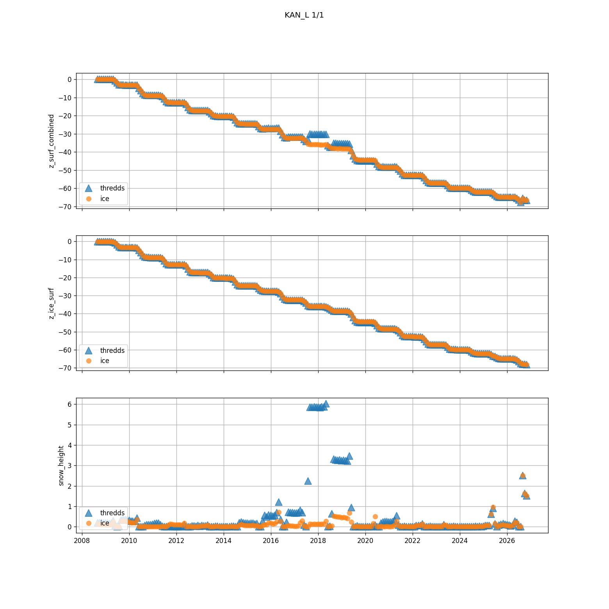
 
## KAN_M
Variables in new file:
p_u, t_u, rh_u, rh_u_wrt_ice_or_water, qh_u, wspd_u, wdir_u, wspd_x_u, wspd_y_u, dsr, dsr_cor, usr, usr_cor, albedo, dlr, ulr, cc, t_surf, dlhf_u, dshf_u, z_boom_u, z_boom_cor_u, z_stake, z_stake_cor, z_pt, z_pt_cor, z_surf_combined, z_ice_surf, snow_height, t_i_1, t_i_2, t_i_3, t_i_4, t_i_5, t_i_6, t_i_7, t_i_8, d_t_i_1, d_t_i_2, d_t_i_3, d_t_i_4, d_t_i_5, d_t_i_6, d_t_i_7, d_t_i_8, t_i_10m, tilt_x, tilt_y, rot_true, gps_lat, gps_lon, gps_alt, lat, lon, alt, batt_v, t_rad

New variables not in old files:

Old variables removed from new files:

 
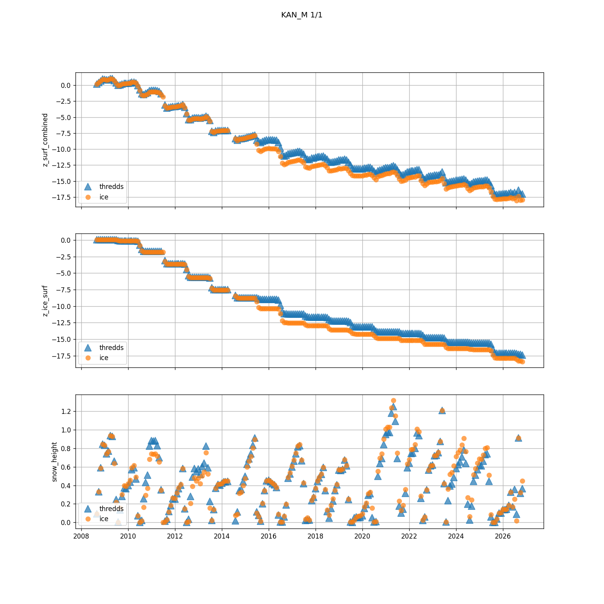
 
## KAN_T
Variables in new file:
p_u, t_u, rh_u, rh_u_wrt_ice_or_water, qh_u, wspd_u, wdir_u, wspd_x_u, wspd_y_u, dsr, dsr_cor, usr, usr_cor, albedo, dlr, ulr, cc, t_surf, dlhf_u, dshf_u, z_boom_u, z_boom_cor_u, z_stake, z_stake_cor, z_pt, z_pt_cor, z_surf_combined, z_ice_surf, snow_height, rainfall_u, rainfall_cor_u, t_i_1, t_i_2, t_i_3, t_i_4, t_i_5, t_i_6, t_i_7, t_i_8, d_t_i_1, d_t_i_2, d_t_i_3, d_t_i_4, d_t_i_5, d_t_i_6, d_t_i_7, d_t_i_8, tilt_x, tilt_y, rot_magnetic, rot_true, gps_lat, gps_lon, gps_alt, lat, lon, alt, batt_v, t_rad

New variables not in old files:

Old variables removed from new files:

 
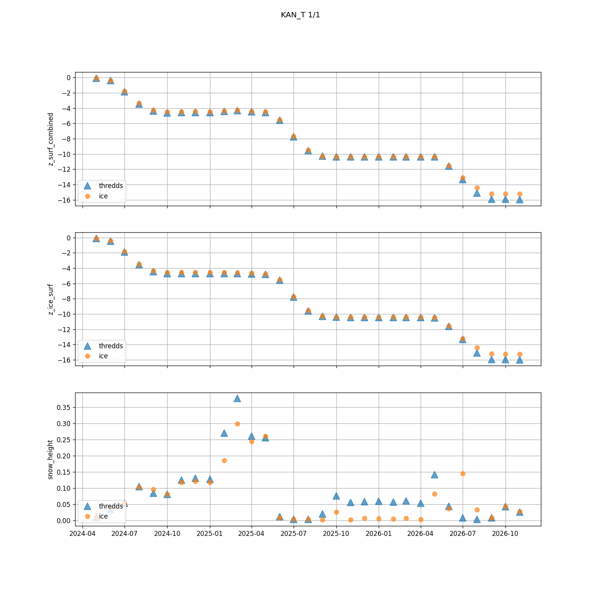
 
## KAN_U
Variables in new file:
p_u, p_l, t_u, t_l, rh_u, rh_u_wrt_ice_or_water, qh_u, rh_l, rh_l_wrt_ice_or_water, qh_l, wspd_u, wspd_l, wdir_u, wdir_l, wspd_x_u, wspd_y_u, wspd_x_l, wspd_y_l, dsr, dsr_cor, usr, usr_cor, albedo, dlr, ulr, cc, t_surf, dlhf_u, dlhf_l, dshf_u, dshf_l, z_boom_u, z_boom_cor_u, z_boom_l, z_boom_cor_l, z_stake, z_stake_cor, z_surf_combined, snow_height, rainfall_u, rainfall_cor_u, rainfall_l, rainfall_cor_l, t_i_1, t_i_2, t_i_3, t_i_4, t_i_5, t_i_6, t_i_7, t_i_8, t_i_9, t_i_10, t_i_11, d_t_i_1, d_t_i_2, d_t_i_3, d_t_i_4, d_t_i_5, d_t_i_6, d_t_i_7, d_t_i_8, d_t_i_9, d_t_i_10, d_t_i_11, t_i_10m, tilt_x, tilt_y, rot_magnetic, rot_true, gps_lat, gps_lon, gps_alt, lat, lon, alt, batt_v, t_rad

New variables not in old files:

Old variables removed from new files:

 
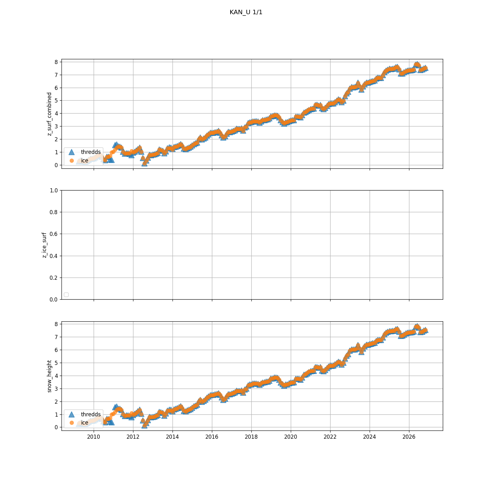
 
## KPC_L
Variables in new file:
p_u, t_u, rh_u, rh_u_wrt_ice_or_water, qh_u, wspd_u, wdir_u, wspd_x_u, wspd_y_u, dsr, dsr_cor, usr, usr_cor, albedo, dlr, ulr, cc, t_surf, dlhf_u, dshf_u, z_boom_u, z_boom_cor_u, z_stake, z_stake_cor, z_pt, z_pt_cor, z_surf_combined, z_ice_surf, snow_height, rainfall_u, rainfall_cor_u, t_i_1, t_i_2, t_i_3, t_i_4, t_i_5, t_i_6, t_i_7, t_i_8, d_t_i_1, d_t_i_2, d_t_i_3, d_t_i_4, d_t_i_5, d_t_i_6, d_t_i_7, d_t_i_8, t_i_10m, tilt_x, tilt_y, rot_magnetic, rot_true, gps_lat, gps_lon, gps_alt, lat, lon, alt, batt_v, t_rad

New variables not in old files:

Old variables removed from new files:

 
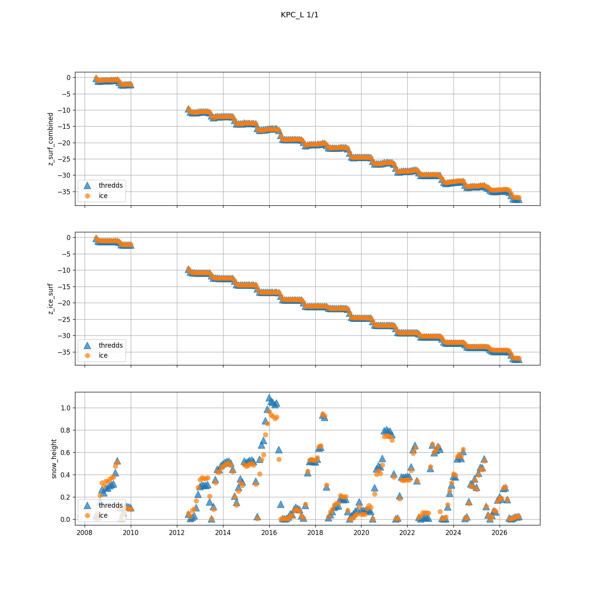
 
## KPC_U
Variables in new file:
p_u, t_u, rh_u, rh_u_wrt_ice_or_water, qh_u, wspd_u, wdir_u, wspd_x_u, wspd_y_u, dsr, dsr_cor, usr, usr_cor, albedo, dlr, ulr, cc, t_surf, dlhf_u, dshf_u, z_boom_u, z_boom_cor_u, z_stake, z_stake_cor, z_surf_combined, z_ice_surf, snow_height, rainfall_u, rainfall_cor_u, t_i_1, t_i_2, t_i_3, t_i_4, t_i_5, t_i_6, t_i_7, t_i_8, d_t_i_1, d_t_i_2, d_t_i_3, d_t_i_4, d_t_i_5, d_t_i_6, d_t_i_7, d_t_i_8, t_i_10m, tilt_x, tilt_y, rot_magnetic, rot_true, gps_lat, gps_lon, gps_alt, lat, lon, alt, batt_v, t_rad

New variables not in old files:

Old variables removed from new files:

 
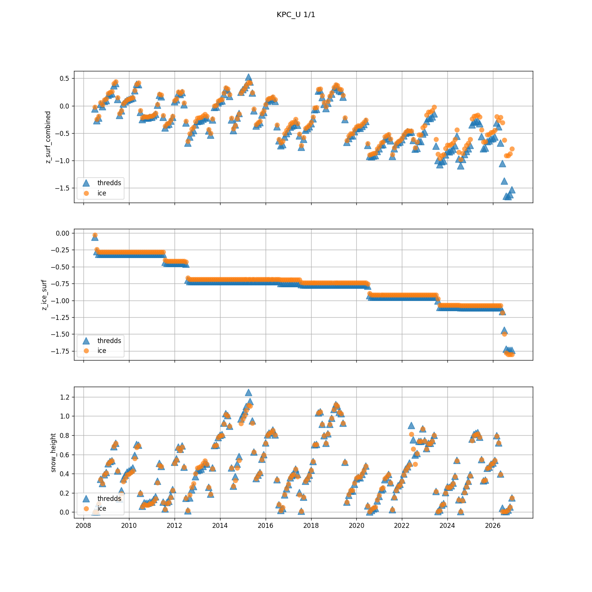
 
## LYN_L
Variables in new file:
p_u, t_u, rh_u, rh_u_wrt_ice_or_water, qh_u, wspd_u, wdir_u, wspd_x_u, wspd_y_u, z_boom_u, z_boom_cor_u, z_stake, z_stake_cor, z_surf_combined, z_ice_surf, snow_height, t_i_1, t_i_2, t_i_3, t_i_4, t_i_5, t_i_6, t_i_7, d_t_i_1, d_t_i_2, d_t_i_3, d_t_i_4, d_t_i_5, d_t_i_6, d_t_i_7, d_t_i_8, t_i_10m, tilt_x, tilt_y, rot_true, gps_lat, gps_lon, gps_alt, lat, lon, alt, batt_v, t_rad

New variables not in old files:

Old variables removed from new files:

 
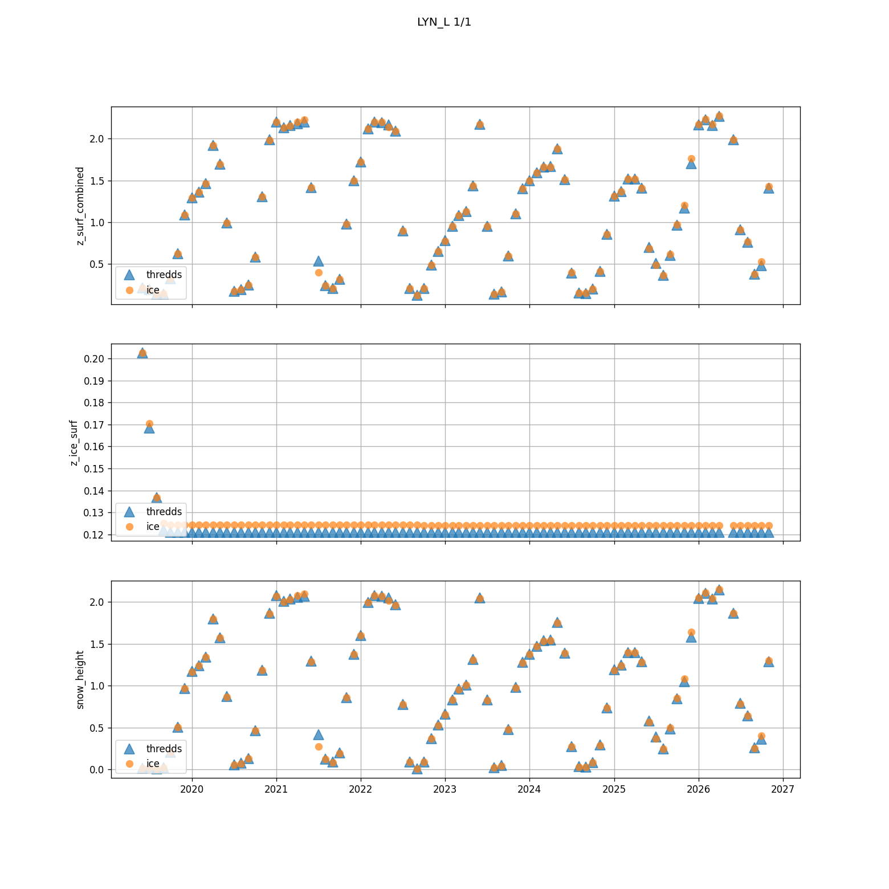
 
## LYN_T
Variables in new file:
p_u, t_u, rh_u, rh_u_wrt_ice_or_water, qh_u, wspd_u, wdir_u, wspd_x_u, wspd_y_u, dsr, dsr_cor, usr, usr_cor, albedo, dlr, ulr, cc, t_surf, z_boom_u, z_boom_cor_u, z_stake, z_stake_cor, z_surf_combined, z_ice_surf, snow_height, t_i_1, t_i_2, t_i_3, t_i_4, t_i_5, t_i_6, t_i_7, d_t_i_1, d_t_i_2, d_t_i_3, d_t_i_4, d_t_i_5, d_t_i_6, d_t_i_7, d_t_i_8, t_i_10m, tilt_x, tilt_y, rot_true, gps_lat, gps_lon, gps_alt, lat, lon, alt, batt_v, t_rad

New variables not in old files:

Old variables removed from new files:

 
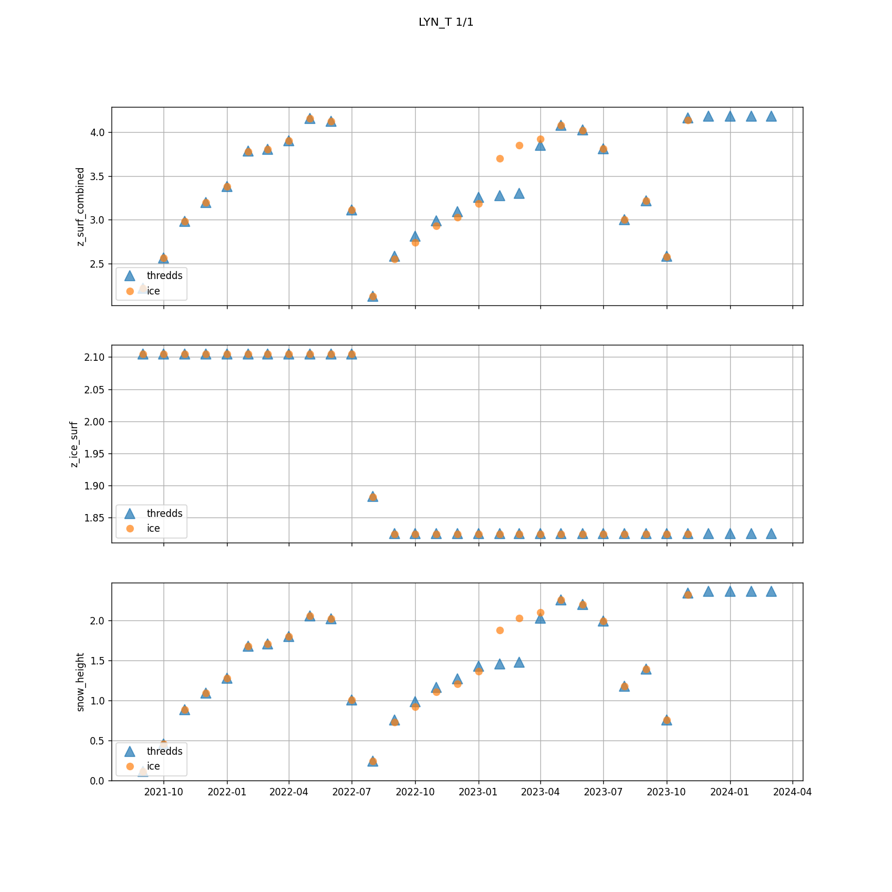
 
## MIT
Variables in new file:
p_u, t_u, rh_u, rh_u_wrt_ice_or_water, qh_u, wspd_u, wdir_u, wspd_x_u, wspd_y_u, dsr, dsr_cor, usr, usr_cor, albedo, dlr, ulr, cc, t_surf, dlhf_u, dshf_u, z_boom_u, z_boom_cor_u, z_stake, z_stake_cor, z_pt, z_pt_cor, z_surf_combined, z_ice_surf, snow_height, t_i_1, t_i_2, t_i_3, t_i_4, t_i_5, t_i_6, t_i_7, t_i_8, d_t_i_1, d_t_i_2, d_t_i_3, d_t_i_4, d_t_i_5, d_t_i_6, d_t_i_7, d_t_i_8, t_i_10m, tilt_x, tilt_y, rot_true, gps_lat, gps_lon, gps_alt, lat, lon, alt, batt_v, t_rad

New variables not in old files:

Old variables removed from new files:

 
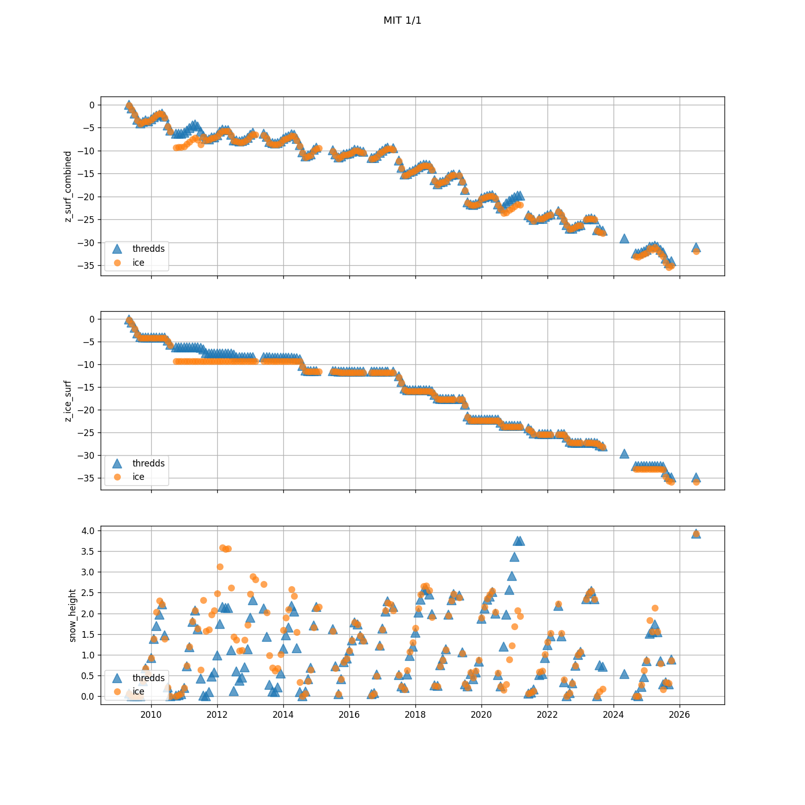
 
## MIT_B
No new file for this station
## NAE
Variables in new file:
p_u, p_l, t_u, t_l, rh_u, rh_u_wrt_ice_or_water, qh_u, rh_l, rh_l_wrt_ice_or_water, qh_l, wspd_u, wspd_l, wdir_u, wdir_l, wspd_x_u, wspd_y_u, wspd_x_l, wspd_y_l, dsr, dsr_cor, usr, usr_cor, albedo, dlr, ulr, cc, t_surf, dlhf_u, dlhf_l, dshf_u, dshf_l, z_boom_u, z_boom_cor_u, z_boom_l, z_boom_cor_l, z_surf_combined, snow_height, rainfall_u, rainfall_cor_u, rainfall_l, rainfall_cor_l, t_i_1, t_i_2, t_i_3, t_i_4, t_i_5, t_i_6, t_i_7, t_i_8, t_i_9, t_i_10, t_i_11, d_t_i_1, d_t_i_2, d_t_i_3, d_t_i_4, d_t_i_5, d_t_i_6, d_t_i_7, d_t_i_8, d_t_i_9, d_t_i_10, d_t_i_11, t_i_10m, tilt_x, tilt_y, rot_magnetic, rot_true, gps_lat, gps_lon, gps_alt, lat, lon, alt, batt_v, t_rad

New variables not in old files:

Old variables removed from new files:

 
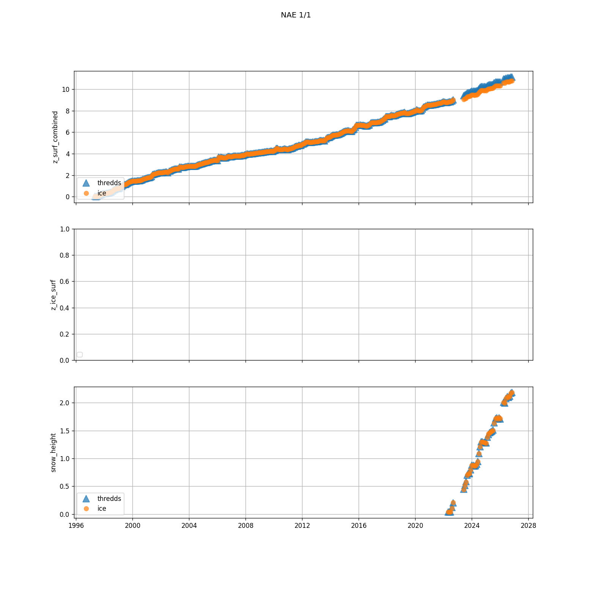
 
## NAU
Variables in new file:
p_u, p_l, t_u, t_l, rh_u, rh_u_wrt_ice_or_water, qh_u, rh_l, rh_l_wrt_ice_or_water, qh_l, wspd_u, wspd_l, wdir_u, wdir_l, wspd_x_u, wspd_y_u, wspd_x_l, wspd_y_l, dsr, dsr_cor, usr, usr_cor, albedo, dlr, ulr, cc, t_surf, dlhf_u, dlhf_l, dshf_u, dshf_l, z_boom_u, z_boom_cor_u, z_boom_l, z_boom_cor_l, z_surf_combined, snow_height, rainfall_u, rainfall_cor_u, rainfall_l, rainfall_cor_l, t_i_1, t_i_2, t_i_3, t_i_4, t_i_5, t_i_6, t_i_7, t_i_8, t_i_9, t_i_10, t_i_11, d_t_i_1, d_t_i_2, d_t_i_3, d_t_i_4, d_t_i_5, d_t_i_6, d_t_i_7, d_t_i_8, d_t_i_9, d_t_i_10, d_t_i_11, t_i_10m, tilt_x, tilt_y, rot_magnetic, rot_true, gps_lat, gps_lon, gps_alt, lat, lon, alt, batt_v, t_rad

New variables not in old files:

Old variables removed from new files:

 
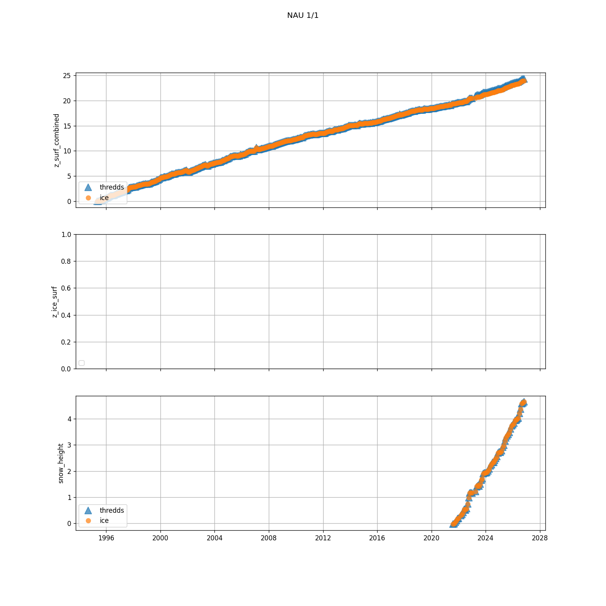
 
## NEM
Variables in new file:
p_u, p_l, t_u, t_l, rh_u, rh_u_wrt_ice_or_water, qh_u, rh_l, rh_l_wrt_ice_or_water, qh_l, wspd_u, wspd_l, wdir_u, wdir_l, wspd_x_u, wspd_y_u, wspd_x_l, wspd_y_l, dsr, dsr_cor, usr, usr_cor, albedo, dlr, ulr, cc, t_surf, dlhf_u, dlhf_l, dshf_u, dshf_l, z_boom_u, z_boom_cor_u, z_boom_l, z_boom_cor_l, z_surf_combined, snow_height, rainfall_u, rainfall_cor_u, rainfall_l, rainfall_cor_l, t_i_1, t_i_2, t_i_3, t_i_4, t_i_5, t_i_6, t_i_7, t_i_8, t_i_9, t_i_10, t_i_11, d_t_i_1, d_t_i_2, d_t_i_3, d_t_i_4, d_t_i_5, d_t_i_6, d_t_i_7, d_t_i_8, d_t_i_9, d_t_i_10, d_t_i_11, t_i_10m, tilt_x, tilt_y, rot_magnetic, rot_true, gps_lat, gps_lon, gps_alt, lat, lon, alt, batt_v, t_rad

New variables not in old files:

Old variables removed from new files:

 
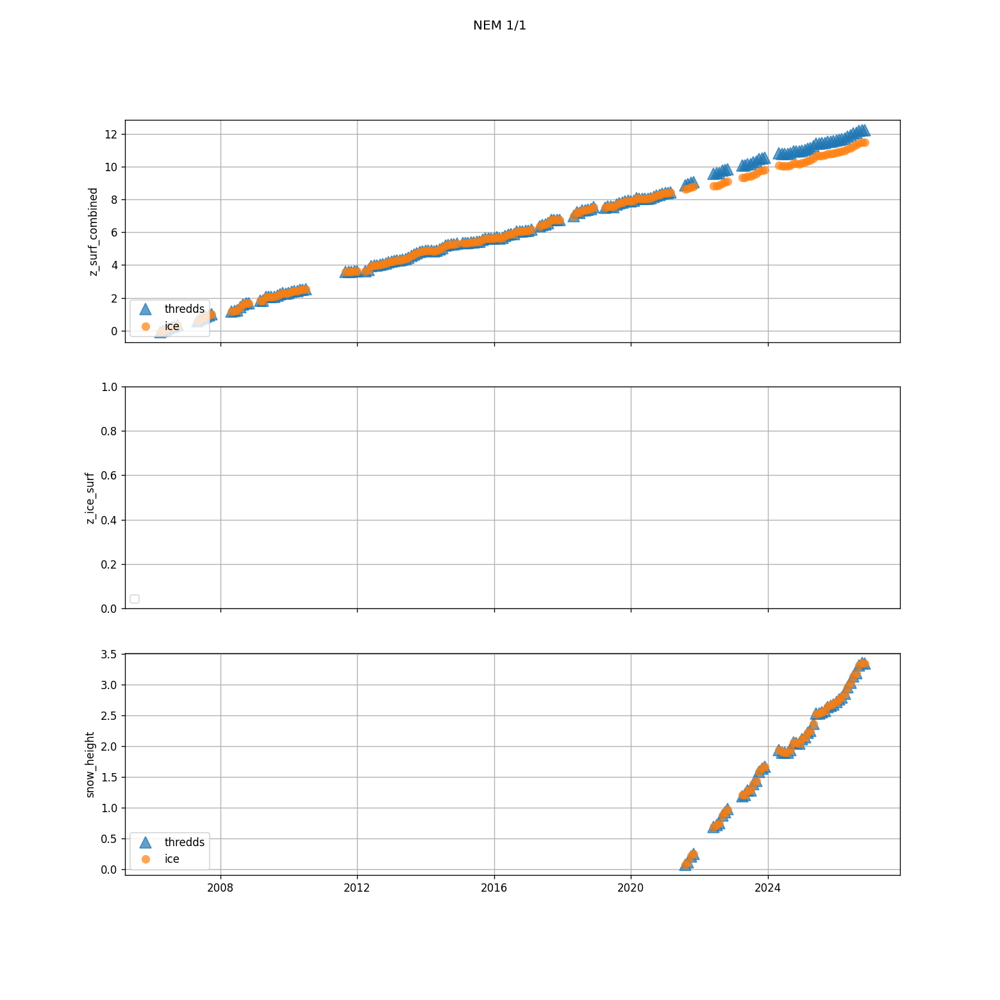
 
## NSE
Variables in new file:
p_u, p_l, t_u, t_l, rh_u, rh_u_wrt_ice_or_water, qh_u, rh_l, rh_l_wrt_ice_or_water, qh_l, wspd_u, wspd_l, wdir_u, wdir_l, wspd_x_u, wspd_y_u, wspd_x_l, wspd_y_l, dsr, dsr_cor, usr, usr_cor, albedo, dlr, ulr, cc, t_surf, dlhf_u, dlhf_l, dshf_u, dshf_l, z_boom_u, z_boom_cor_u, z_boom_l, z_boom_cor_l, z_surf_combined, snow_height, rainfall_u, rainfall_cor_u, rainfall_l, rainfall_cor_l, t_i_1, t_i_2, t_i_3, t_i_4, t_i_5, t_i_6, t_i_7, t_i_8, t_i_9, t_i_10, t_i_11, d_t_i_1, d_t_i_2, d_t_i_3, d_t_i_4, d_t_i_5, d_t_i_6, d_t_i_7, d_t_i_8, d_t_i_9, d_t_i_10, d_t_i_11, t_i_10m, tilt_x, tilt_y, rot_magnetic, rot_true, gps_lat, gps_lon, gps_alt, lat, lon, alt, batt_v, t_rad

New variables not in old files:

Old variables removed from new files:

 
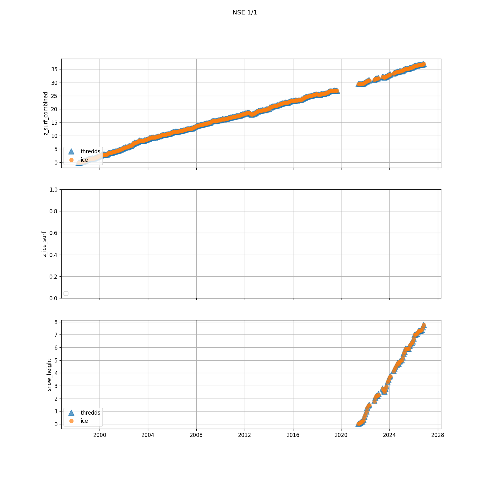
 
## NUK_B
Variables in new file:
p_u, t_u, rh_u, rh_u_wrt_ice_or_water, qh_u, wspd_u, wdir_u, wspd_x_u, wspd_y_u, dsr, usr, albedo, dlr, ulr, t_surf, z_boom_u, z_boom_cor_u, z_surf_combined, snow_height, rainfall_u, rainfall_cor_u, tilt_x, tilt_y, rot_magnetic, rot_true, gps_lat, gps_lon, gps_alt, lat, lon, alt, batt_v, t_rad

New variables not in old files:

Old variables removed from new files:

 
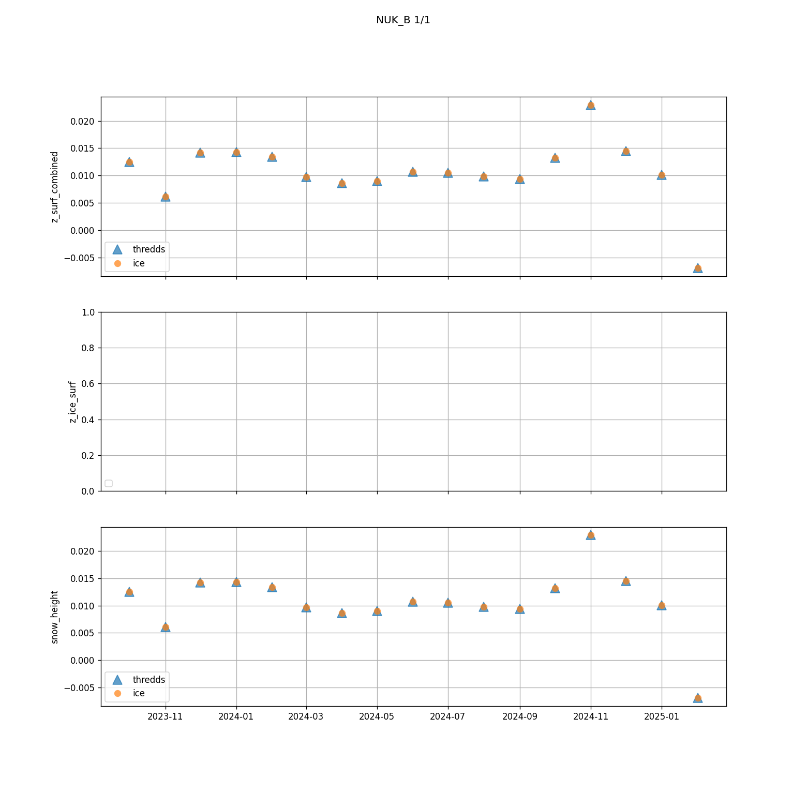
 
## NUK_K
Variables in new file:
p_u, t_u, rh_u, rh_u_wrt_ice_or_water, qh_u, wspd_u, wdir_u, wspd_x_u, wspd_y_u, dsr, dsr_cor, usr, usr_cor, albedo, dlr, ulr, cc, t_surf, dlhf_u, dshf_u, z_boom_u, z_boom_cor_u, z_stake, z_stake_cor, z_pt, z_pt_cor, z_surf_combined, z_ice_surf, snow_height, rainfall_u, rainfall_cor_u, t_i_1, t_i_2, t_i_3, t_i_4, t_i_5, t_i_6, t_i_7, t_i_8, d_t_i_1, d_t_i_2, d_t_i_3, d_t_i_4, d_t_i_5, d_t_i_6, d_t_i_7, d_t_i_8, t_i_10m, tilt_x, tilt_y, rot_magnetic, rot_true, gps_lat, gps_lon, gps_alt, lat, lon, alt, batt_v, t_rad

New variables not in old files:

Old variables removed from new files:

 
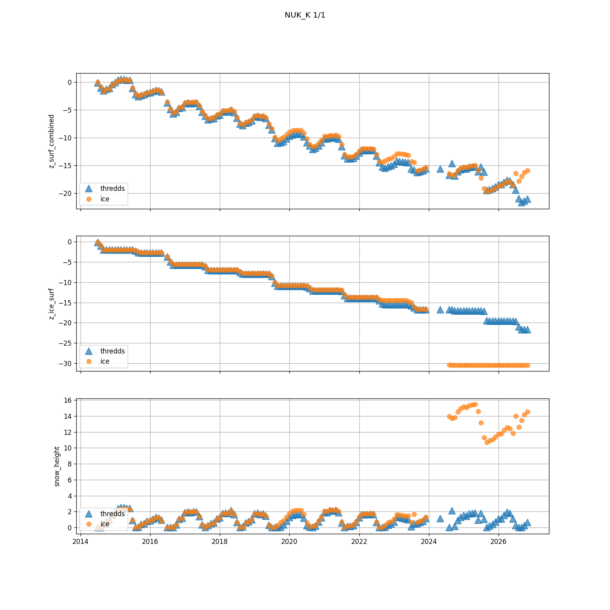
 
## NUK_L
Variables in new file:
p_u, t_u, rh_u, rh_u_wrt_ice_or_water, qh_u, wspd_u, wdir_u, wspd_x_u, wspd_y_u, dsr, dsr_cor, usr, usr_cor, albedo, dlr, ulr, cc, t_surf, dlhf_u, dshf_u, z_boom_u, z_boom_cor_u, z_stake, z_stake_cor, z_pt, z_pt_cor, z_surf_combined, z_ice_surf, snow_height, rainfall_u, rainfall_cor_u, t_i_1, t_i_2, t_i_3, t_i_4, t_i_5, t_i_6, t_i_7, t_i_8, d_t_i_1, d_t_i_2, d_t_i_3, d_t_i_4, d_t_i_5, d_t_i_6, d_t_i_7, d_t_i_8, t_i_10m, tilt_x, tilt_y, rot_magnetic, rot_true, gps_lat, gps_lon, gps_alt, lat, lon, alt, batt_v, t_rad

New variables not in old files:

Old variables removed from new files:

 
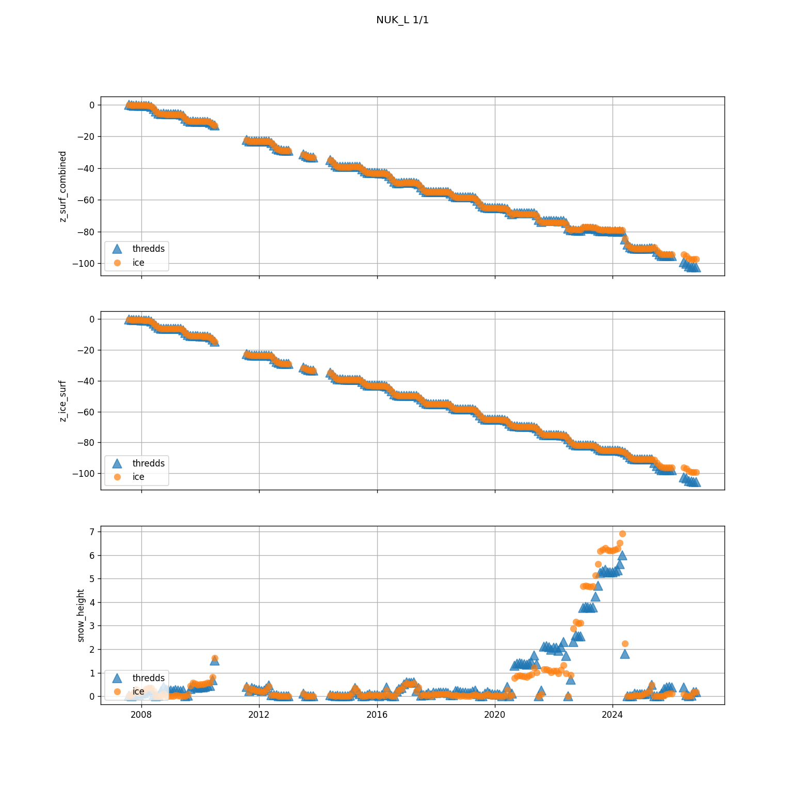
 
## NUK_N
Variables in new file:
p_u, t_u, rh_u, rh_u_wrt_ice_or_water, qh_u, wspd_u, wdir_u, wspd_x_u, wspd_y_u, dsr, dsr_cor, usr, usr_cor, albedo, dlr, ulr, cc, t_surf, dlhf_u, dshf_u, z_boom_u, z_boom_cor_u, z_stake, z_stake_cor, z_pt, z_pt_cor, z_surf_combined, z_ice_surf, snow_height, t_i_1, t_i_2, t_i_3, t_i_4, t_i_5, t_i_6, t_i_7, t_i_8, d_t_i_1, d_t_i_2, d_t_i_3, d_t_i_4, d_t_i_5, d_t_i_6, d_t_i_7, d_t_i_8, t_i_10m, tilt_x, tilt_y, rot_true, gps_lat, gps_lon, gps_alt, lat, lon, alt, batt_v, t_rad

New variables not in old files:

Old variables removed from new files:

 
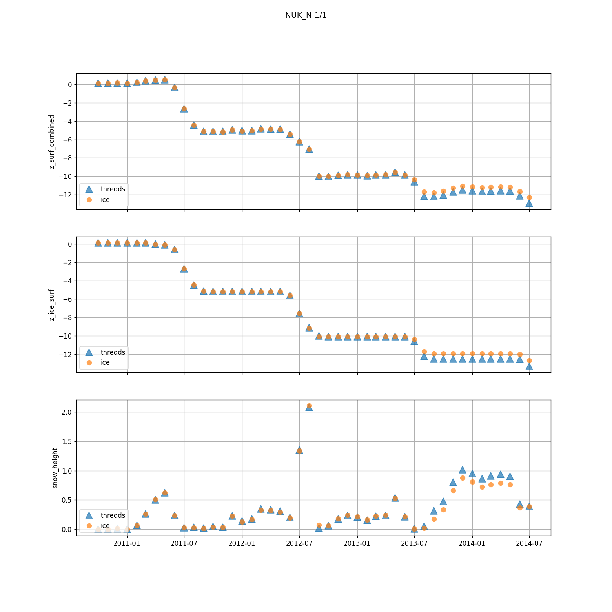
 
## NUK_P
## NUK_U
Variables in new file:
p_u, t_u, rh_u, rh_u_wrt_ice_or_water, qh_u, wspd_u, wdir_u, wspd_x_u, wspd_y_u, dsr, dsr_cor, usr, usr_cor, albedo, dlr, ulr, cc, t_surf, dlhf_u, dshf_u, z_boom_u, z_boom_cor_u, z_stake, z_stake_cor, z_pt, z_pt_cor, z_surf_combined, z_ice_surf, snow_height, rainfall_u, rainfall_cor_u, t_i_1, t_i_2, t_i_3, t_i_4, t_i_5, t_i_6, t_i_7, t_i_8, d_t_i_1, d_t_i_2, d_t_i_3, d_t_i_4, d_t_i_5, d_t_i_6, d_t_i_7, d_t_i_8, t_i_10m, tilt_x, tilt_y, rot_magnetic, rot_true, gps_lat, gps_lon, gps_alt, lat, lon, alt, batt_v, t_rad

New variables not in old files:

Old variables removed from new files:

 
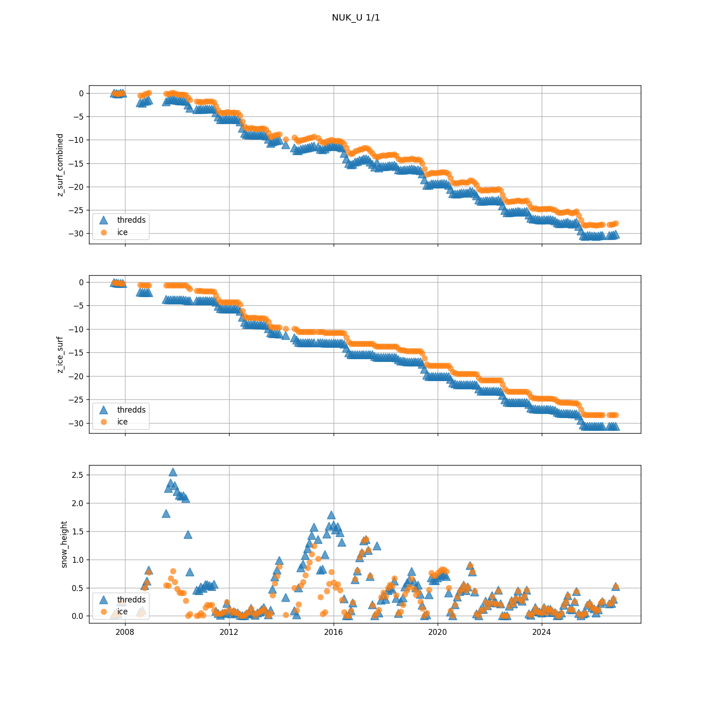
 
## ORO
## QAS_A
Variables in new file:
p_u, t_u, rh_u, rh_u_wrt_ice_or_water, qh_u, wspd_u, wdir_u, wspd_x_u, wspd_y_u, dsr, dsr_cor, usr, usr_cor, albedo, dlr, ulr, cc, t_surf, dlhf_u, dshf_u, z_boom_u, z_boom_cor_u, z_stake, z_stake_cor, z_surf_combined, z_ice_surf, snow_height, t_i_1, t_i_2, t_i_3, t_i_4, t_i_5, t_i_6, t_i_7, t_i_8, d_t_i_1, d_t_i_2, d_t_i_3, d_t_i_4, d_t_i_5, d_t_i_6, d_t_i_7, d_t_i_8, t_i_10m, tilt_x, tilt_y, rot_true, gps_lat, gps_lon, gps_alt, lat, lon, alt, batt_v, t_rad

New variables not in old files:

Old variables removed from new files:

 
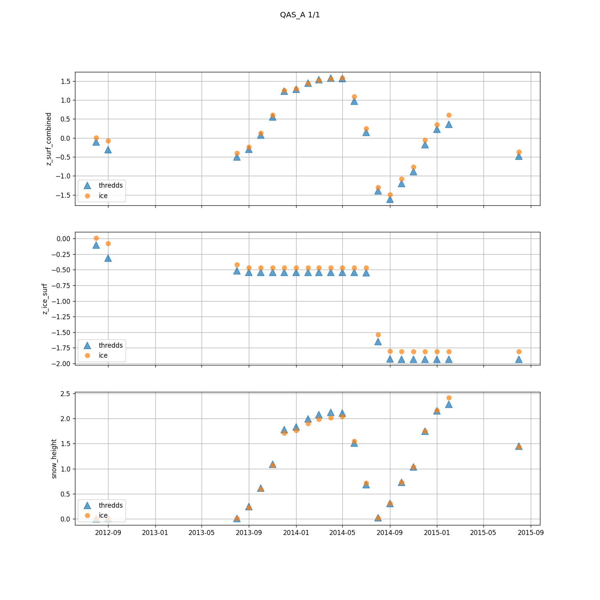
 
## QAS_L
Variables in new file:
p_u, t_u, rh_u, rh_u_wrt_ice_or_water, qh_u, wspd_u, wdir_u, wspd_x_u, wspd_y_u, dsr, dsr_cor, usr, usr_cor, albedo, dlr, ulr, cc, t_surf, dlhf_u, dshf_u, z_boom_u, z_boom_cor_u, z_stake, z_stake_cor, z_pt, z_pt_cor, z_surf_combined, z_ice_surf, snow_height, rainfall_u, rainfall_cor_u, t_i_1, t_i_2, t_i_3, t_i_4, t_i_5, t_i_6, t_i_7, t_i_8, d_t_i_1, d_t_i_2, d_t_i_3, d_t_i_4, d_t_i_5, d_t_i_6, d_t_i_7, d_t_i_8, t_i_10m, tilt_x, tilt_y, rot_magnetic, rot_true, gps_lat, gps_lon, gps_alt, lat, lon, alt, batt_v, t_rad

New variables not in old files:

Old variables removed from new files:

 
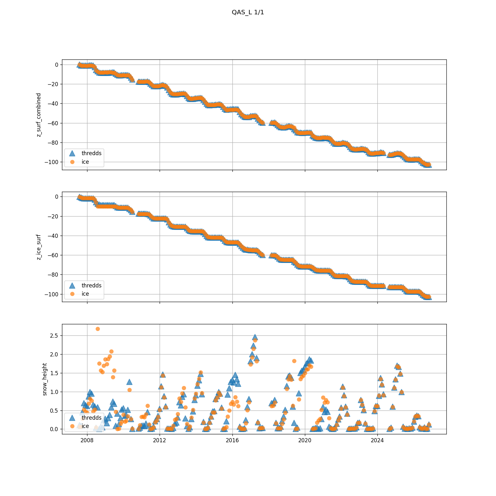
 
## QAS_M
Variables in new file:
p_u, t_u, rh_u, rh_u_wrt_ice_or_water, qh_u, wspd_u, wdir_u, wspd_x_u, wspd_y_u, dsr, dsr_cor, usr, usr_cor, albedo, dlr, ulr, cc, t_surf, dlhf_u, dshf_u, z_boom_u, z_boom_cor_u, z_stake, z_stake_cor, z_pt, z_pt_cor, z_surf_combined, z_ice_surf, snow_height, rainfall_u, rainfall_cor_u, t_i_1, t_i_2, t_i_3, t_i_4, t_i_5, t_i_6, t_i_7, t_i_8, d_t_i_1, d_t_i_2, d_t_i_3, d_t_i_4, d_t_i_5, d_t_i_6, d_t_i_7, d_t_i_8, t_i_10m, tilt_x, tilt_y, rot_magnetic, rot_true, gps_lat, gps_lon, gps_alt, lat, lon, alt, batt_v, t_rad

New variables not in old files:

Old variables removed from new files:

 
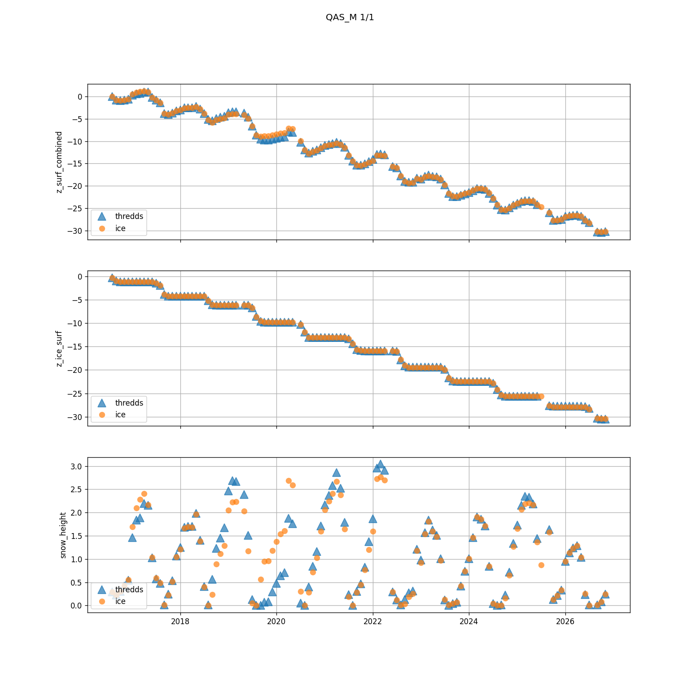
 
## QAS_U
Variables in new file:
p_u, t_u, rh_u, rh_u_wrt_ice_or_water, qh_u, wspd_u, wdir_u, wspd_x_u, wspd_y_u, dsr, dsr_cor, usr, usr_cor, albedo, dlr, ulr, cc, t_surf, dlhf_u, dshf_u, z_boom_u, z_boom_cor_u, z_stake, z_stake_cor, z_pt, z_pt_cor, z_surf_combined, z_ice_surf, snow_height, rainfall_u, rainfall_cor_u, t_i_1, t_i_2, t_i_3, t_i_4, t_i_5, t_i_6, t_i_7, t_i_8, d_t_i_1, d_t_i_2, d_t_i_3, d_t_i_4, d_t_i_5, d_t_i_6, d_t_i_7, d_t_i_8, t_i_10m, tilt_x, tilt_y, rot_magnetic, rot_true, gps_lat, gps_lon, gps_alt, lat, lon, alt, batt_v, t_rad

New variables not in old files:

Old variables removed from new files:

 
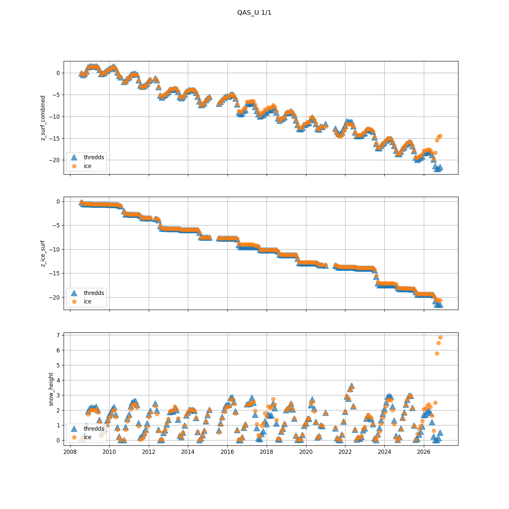
 
## RED_L
Variables in new file:
p_u, t_u, rh_u, rh_u_wrt_ice_or_water, qh_u, wspd_u, wdir_u, wspd_x_u, wspd_y_u, dsr, dsr_cor, usr, usr_cor, albedo, dlr, ulr, cc, t_surf, dlhf_u, dshf_u, z_boom_u, z_boom_cor_u, z_stake, z_stake_cor, z_surf_combined, z_ice_surf, snow_height, rainfall_u, rainfall_cor_u, t_i_1, t_i_2, t_i_3, t_i_4, t_i_5, t_i_6, t_i_7, t_i_8, d_t_i_1, d_t_i_2, d_t_i_3, d_t_i_4, d_t_i_5, d_t_i_6, d_t_i_7, d_t_i_8, t_i_10m, tilt_x, tilt_y, rot_magnetic, rot_true, gps_lat, gps_lon, gps_alt, lat, lon, alt, batt_v, t_rad

New variables not in old files:

Old variables removed from new files:

 
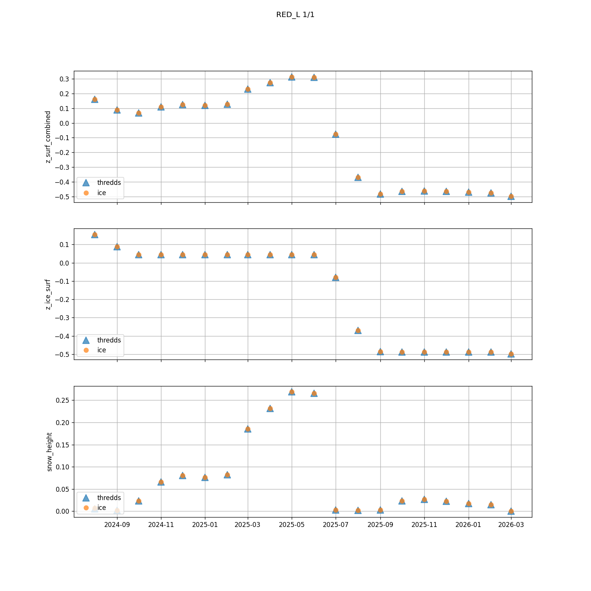
 
## SCO_L
Variables in new file:
p_u, t_u, rh_u, rh_u_wrt_ice_or_water, qh_u, wspd_u, wdir_u, wspd_x_u, wspd_y_u, dsr, dsr_cor, usr, usr_cor, albedo, dlr, ulr, cc, t_surf, dlhf_u, dshf_u, z_boom_u, z_boom_cor_u, z_stake, z_stake_cor, z_pt, z_pt_cor, z_surf_combined, z_ice_surf, snow_height, rainfall_u, rainfall_cor_u, t_i_1, t_i_2, t_i_3, t_i_4, t_i_5, t_i_6, t_i_7, t_i_8, d_t_i_1, d_t_i_2, d_t_i_3, d_t_i_4, d_t_i_5, d_t_i_6, d_t_i_7, d_t_i_8, t_i_10m, tilt_x, tilt_y, rot_magnetic, rot_true, gps_lat, gps_lon, gps_alt, lat, lon, alt, batt_v, t_rad

New variables not in old files:

Old variables removed from new files:

 
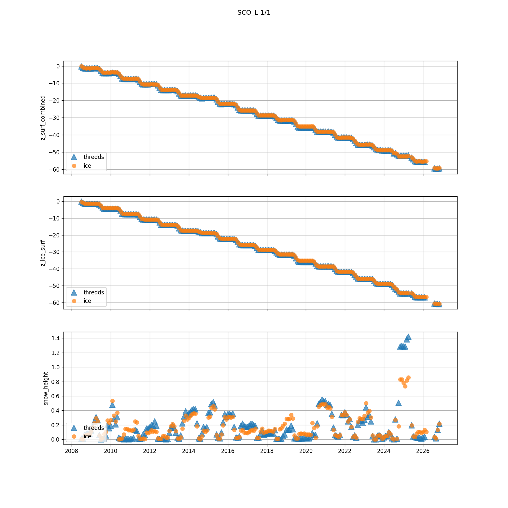
 
## SCO_U
Variables in new file:
p_u, t_u, rh_u, rh_u_wrt_ice_or_water, qh_u, wspd_u, wdir_u, wspd_x_u, wspd_y_u, dsr, dsr_cor, usr, usr_cor, albedo, dlr, ulr, cc, t_surf, dlhf_u, dshf_u, z_boom_u, z_boom_cor_u, z_stake, z_stake_cor, z_pt, z_pt_cor, z_surf_combined, z_ice_surf, snow_height, rainfall_u, rainfall_cor_u, t_i_1, t_i_2, t_i_3, t_i_4, t_i_5, t_i_6, t_i_7, t_i_8, d_t_i_1, d_t_i_2, d_t_i_3, d_t_i_4, d_t_i_5, d_t_i_6, d_t_i_7, d_t_i_8, t_i_10m, tilt_x, tilt_y, rot_magnetic, rot_true, gps_lat, gps_lon, gps_alt, lat, lon, alt, batt_v, t_rad

New variables not in old files:

Old variables removed from new files:

 
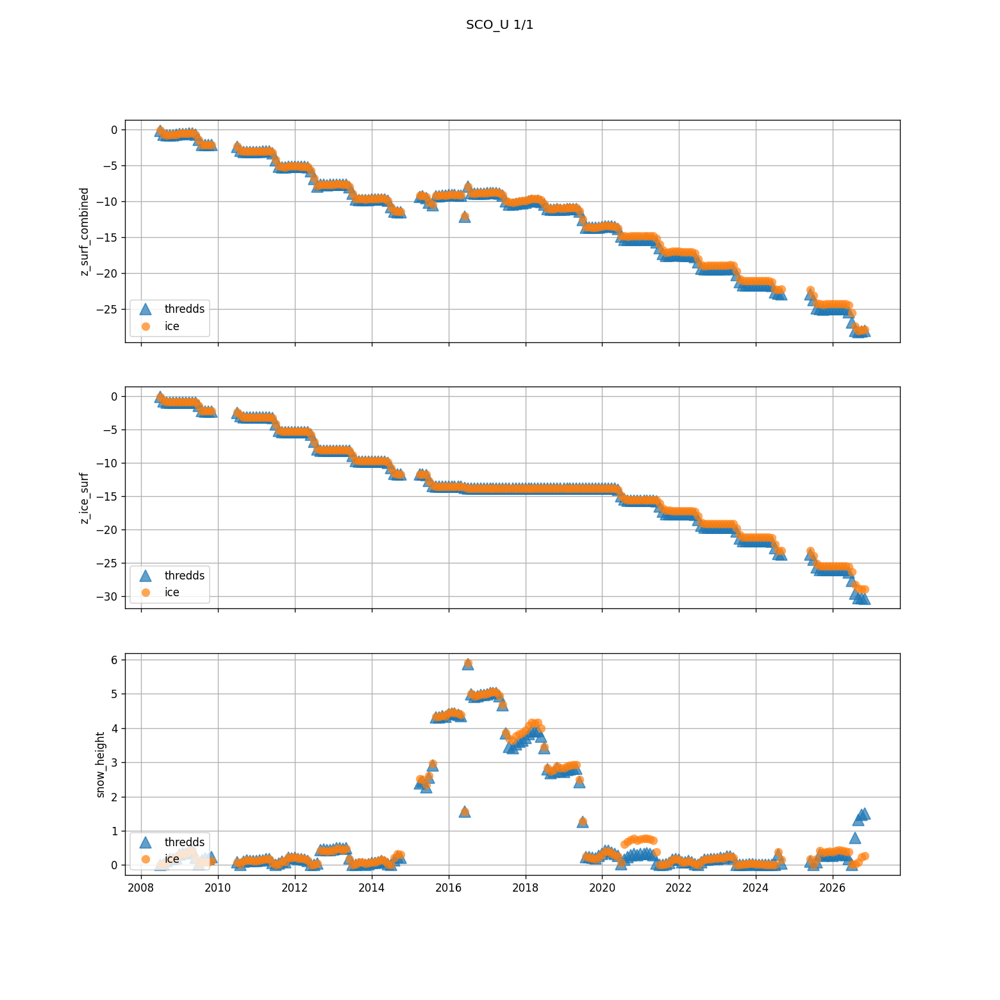
 
## SDL
Variables in new file:
p_u, p_l, t_u, t_l, rh_u, rh_u_wrt_ice_or_water, qh_u, rh_l, rh_l_wrt_ice_or_water, qh_l, wspd_u, wspd_l, wdir_u, wdir_l, wspd_x_u, wspd_y_u, wspd_x_l, wspd_y_l, dsr, dsr_cor, usr, usr_cor, albedo, dlr, ulr, cc, t_surf, dlhf_u, dlhf_l, dshf_u, dshf_l, z_boom_u, z_boom_cor_u, z_boom_l, z_boom_cor_l, z_surf_combined, snow_height, rainfall_u, rainfall_cor_u, rainfall_l, rainfall_cor_l, t_i_1, t_i_2, t_i_3, t_i_4, t_i_5, t_i_6, t_i_7, t_i_8, t_i_9, t_i_10, t_i_11, d_t_i_1, d_t_i_2, d_t_i_3, d_t_i_4, d_t_i_5, d_t_i_6, d_t_i_7, d_t_i_8, d_t_i_9, d_t_i_10, d_t_i_11, t_i_10m, tilt_x, tilt_y, rot_magnetic, rot_true, gps_lat, gps_lon, gps_alt, lat, lon, alt, batt_v, t_rad

New variables not in old files:

Old variables removed from new files:

 
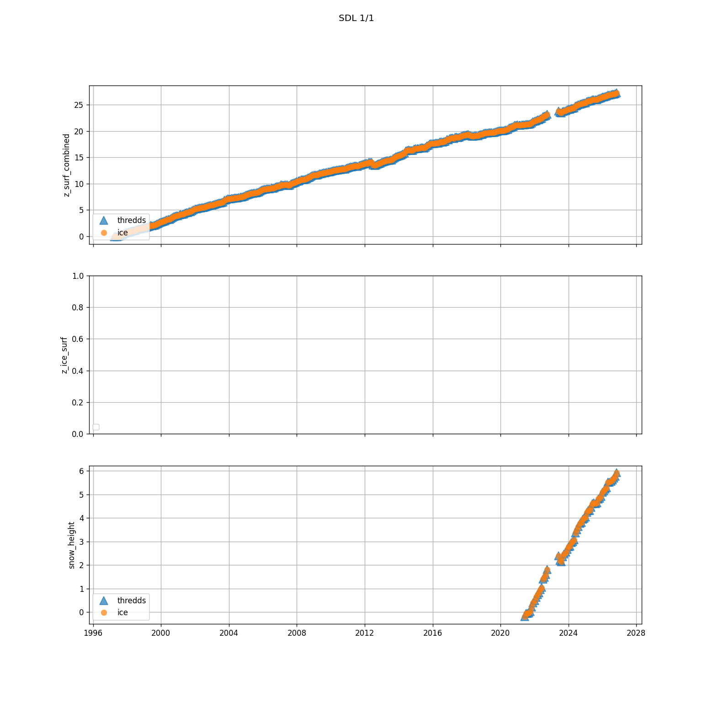
 
## SDM
Variables in new file:
p_u, p_l, t_u, t_l, rh_u, rh_u_wrt_ice_or_water, qh_u, rh_l, rh_l_wrt_ice_or_water, qh_l, wspd_u, wspd_l, wdir_u, wdir_l, wspd_x_u, wspd_y_u, wspd_x_l, wspd_y_l, dsr, dsr_cor, usr, usr_cor, albedo, dlr, ulr, cc, t_surf, dlhf_u, dlhf_l, dshf_u, dshf_l, z_boom_u, z_boom_cor_u, z_boom_l, z_boom_cor_l, z_surf_combined, snow_height, rainfall_u, rainfall_cor_u, rainfall_l, rainfall_cor_l, t_i_1, t_i_2, t_i_3, t_i_4, t_i_5, t_i_6, t_i_7, t_i_8, t_i_9, t_i_10, t_i_11, d_t_i_1, d_t_i_2, d_t_i_3, d_t_i_4, d_t_i_5, d_t_i_6, d_t_i_7, d_t_i_8, d_t_i_9, d_t_i_10, d_t_i_11, t_i_10m, tilt_x, tilt_y, rot_magnetic, rot_true, gps_lat, gps_lon, gps_alt, lat, lon, alt, batt_v, t_rad

New variables not in old files:

Old variables removed from new files:

 
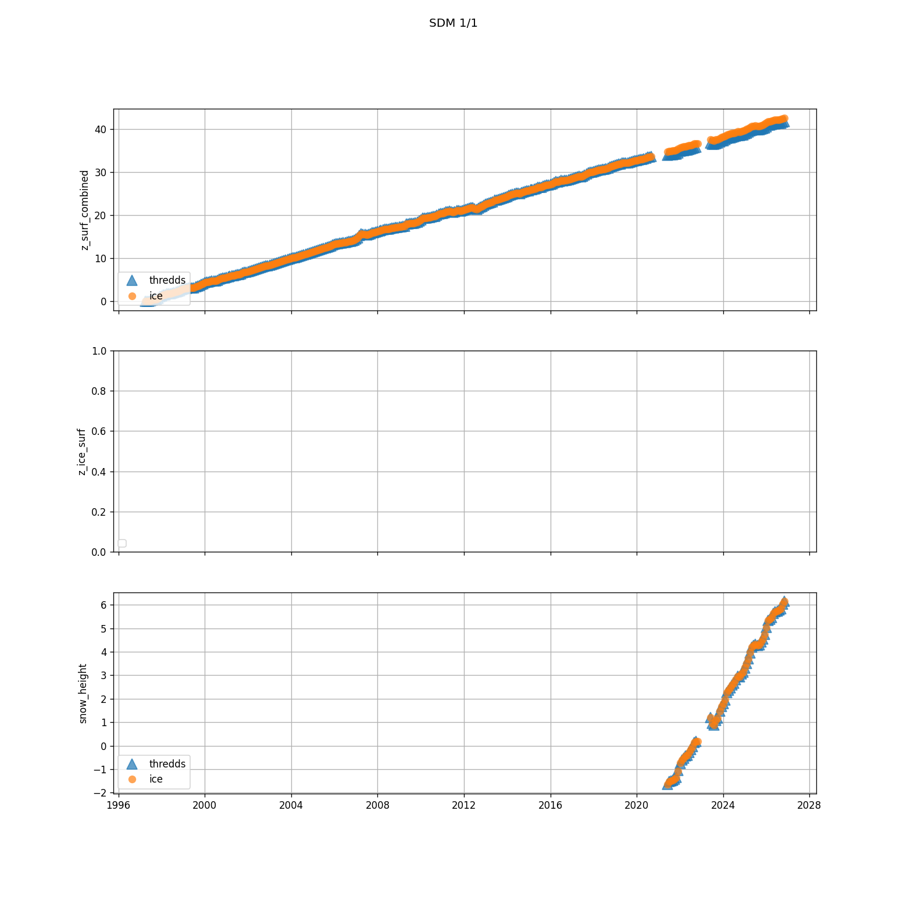
 
## SER_B
Variables in new file:
p_u, t_u, rh_u, rh_u_wrt_ice_or_water, qh_u, wspd_u, wdir_u, wspd_x_u, wspd_y_u, dsr, usr, albedo, dlr, ulr, t_surf, z_boom_u, z_boom_cor_u, z_surf_combined, snow_height, rainfall_u, rainfall_cor_u, tilt_x, tilt_y, rot_magnetic, rot_true, gps_lat, gps_lon, gps_alt, lat, lon, alt, batt_v, t_rad

New variables not in old files:

Old variables removed from new files:

 
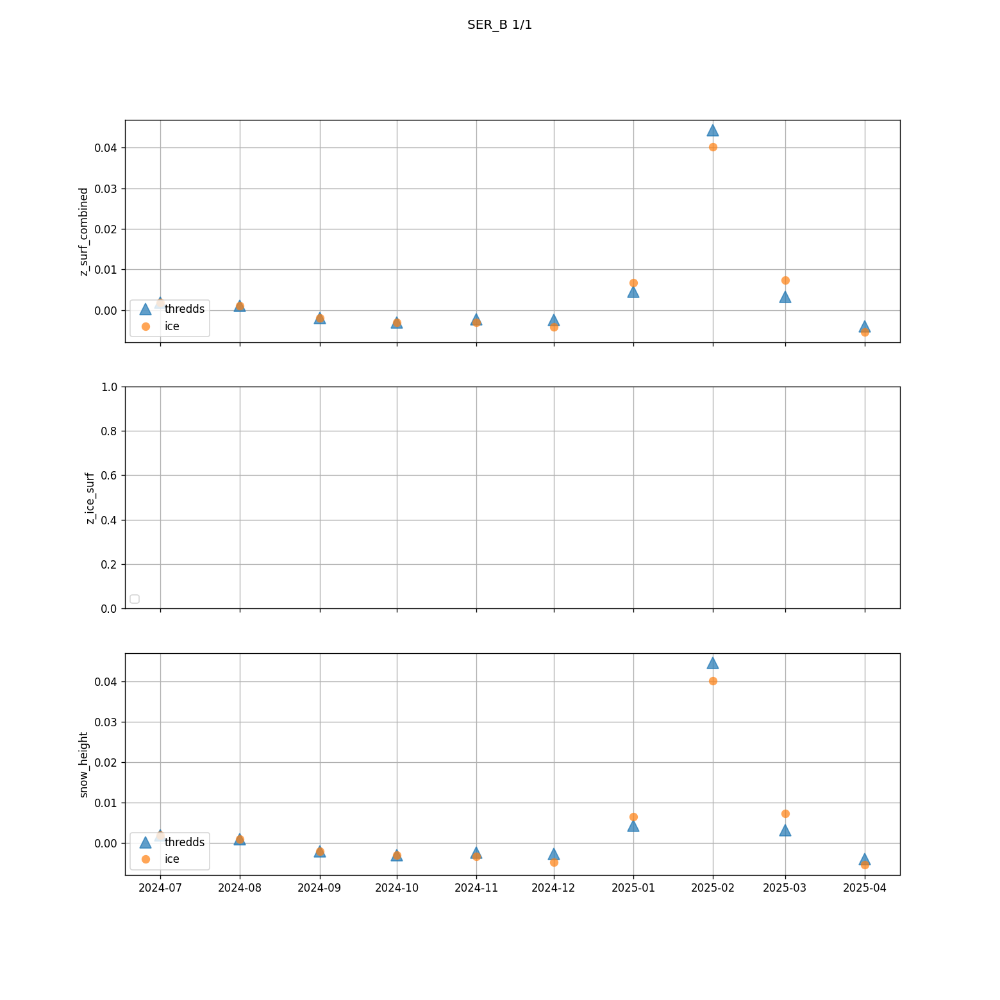
 
## STA
Variables in new file:
p_u, t_u, t_l, rh_u, rh_u_wrt_ice_or_water, qh_u, rh_l, rh_l_wrt_ice_or_water, wspd_u, wspd_l, wdir_u, wdir_l, wspd_x_u, wspd_y_u, wspd_x_l, wspd_y_l, dsr, dsr_cor, usr, usr_cor, albedo, dlr, ulr, cc, t_surf, dlhf_u, dshf_u, z_boom_u, z_boom_cor_u, z_boom_l, z_boom_cor_l, z_surf_combined, snow_height, rainfall_u, rainfall_cor_u, t_i_1, t_i_2, t_i_3, t_i_4, t_i_5, t_i_6, t_i_7, t_i_8, t_i_9, t_i_10, t_i_11, d_t_i_1, d_t_i_2, d_t_i_3, d_t_i_4, d_t_i_5, d_t_i_6, d_t_i_7, d_t_i_8, d_t_i_9, d_t_i_10, d_t_i_11, t_i_10m, tilt_x, tilt_y, rot_magnetic, rot_true, gps_lat, gps_lon, gps_alt, lat, lon, alt, batt_v, t_rad

New variables not in old files:

Old variables removed from new files:

 
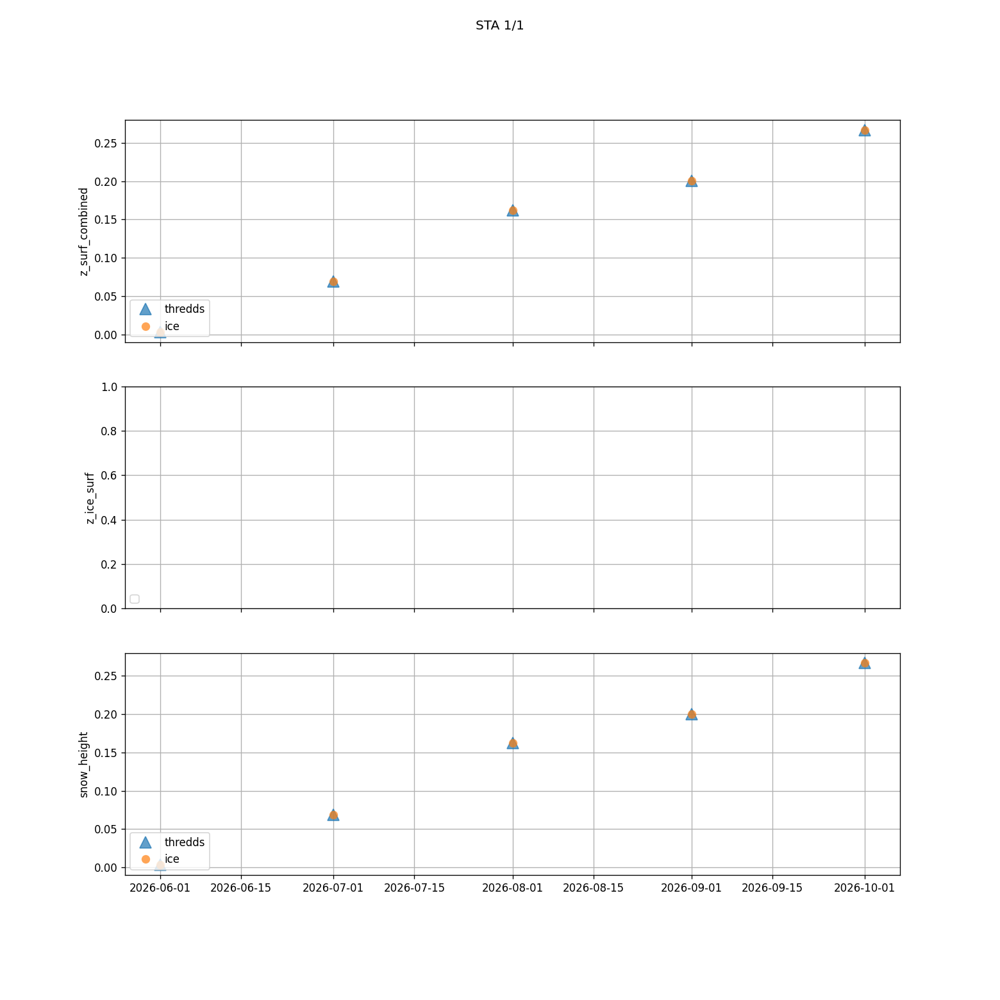
 
## SUM
Variables in new file:
p_u, t_u, t_l, rh_u, rh_u_wrt_ice_or_water, qh_u, rh_l, rh_l_wrt_ice_or_water, wspd_u, wspd_l, wdir_u, wdir_l, wspd_x_u, wspd_y_u, wspd_x_l, wspd_y_l, dsr, dsr_cor, usr, usr_cor, albedo, dlr, ulr, cc, t_surf, dlhf_u, dshf_u, z_boom_u, z_boom_cor_u, z_boom_l, z_boom_cor_l, z_surf_combined, snow_height, rainfall_u, rainfall_cor_u, t_i_1, t_i_2, t_i_3, t_i_4, t_i_5, t_i_6, t_i_7, t_i_8, t_i_9, t_i_10, t_i_11, d_t_i_1, d_t_i_2, d_t_i_3, d_t_i_4, d_t_i_5, d_t_i_6, d_t_i_7, d_t_i_8, d_t_i_9, d_t_i_10, d_t_i_11, t_i_10m, tilt_x, tilt_y, rot_magnetic, rot_true, gps_lat, gps_lon, gps_alt, lat, lon, alt, batt_v, t_rad

New variables not in old files:

Old variables removed from new files:

 
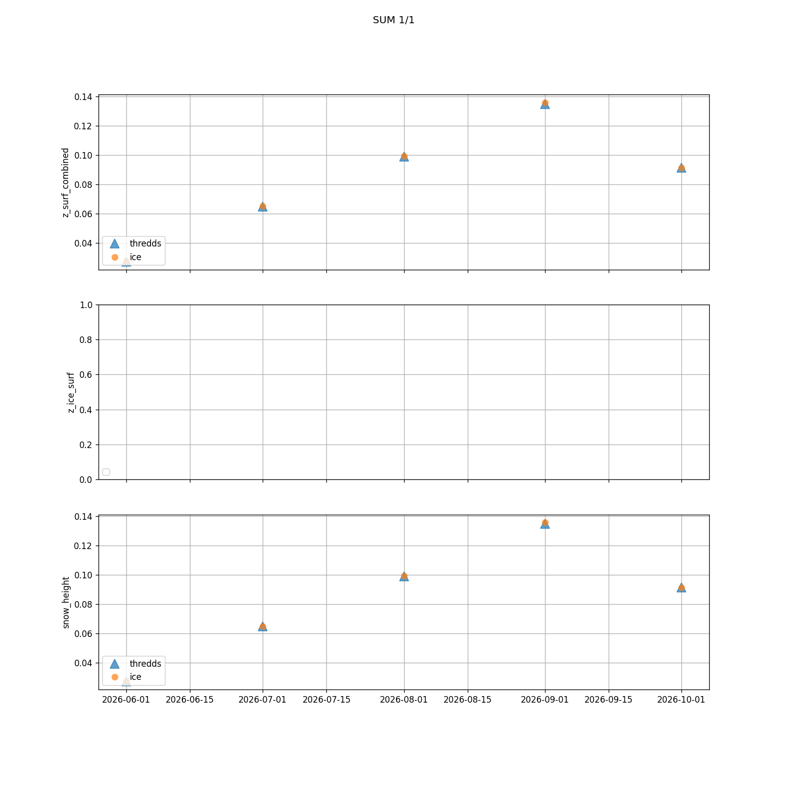
 
## SWC
Variables in new file:
p_u, t_u, t_l, rh_u, rh_u_wrt_ice_or_water, qh_u, rh_l, rh_l_wrt_ice_or_water, qh_l, wspd_u, wspd_l, wdir_u, wdir_l, wspd_x_u, wspd_y_u, wspd_x_l, wspd_y_l, dsr, dsr_cor, usr, usr_cor, albedo, dlr, ulr, cc, t_surf, dlhf_u, dshf_u, z_boom_u, z_boom_cor_u, z_boom_cor_l, z_stake, z_stake_cor, z_pt, z_pt_cor, z_surf_combined, z_ice_surf, snow_height, rainfall_u, rainfall_cor_u, t_i_1, t_i_2, t_i_3, t_i_4, t_i_5, t_i_6, t_i_7, t_i_8, t_i_9, t_i_10, d_t_i_1, d_t_i_2, d_t_i_3, d_t_i_4, d_t_i_5, d_t_i_6, d_t_i_7, d_t_i_8, d_t_i_9, d_t_i_10, t_i_10m, tilt_x, tilt_y, rot_magnetic, rot_true, gps_lat, gps_lon, gps_alt, lat, lon, alt, batt_v, t_rad

New variables not in old files:

Old variables removed from new files:

 
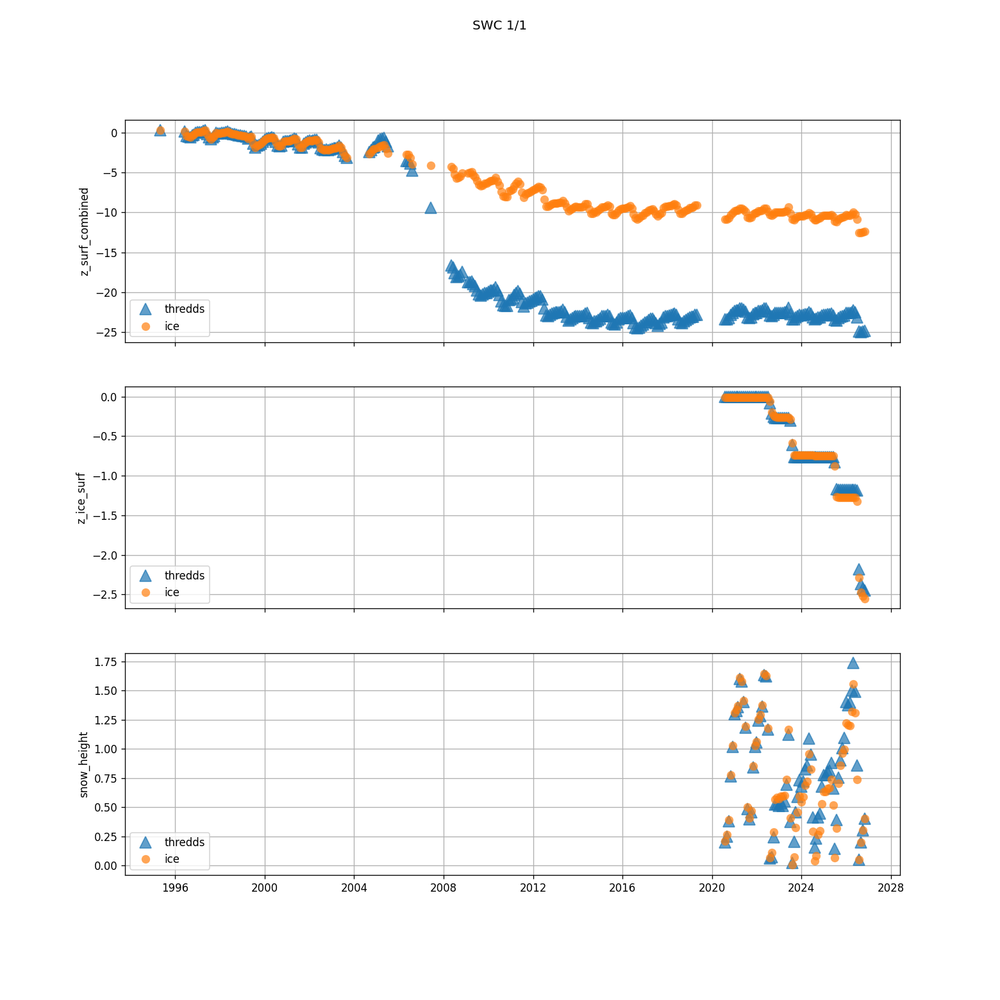
 
## TAS_A
Variables in new file:
p_u, t_u, rh_u, rh_u_wrt_ice_or_water, qh_u, wspd_u, wdir_u, wspd_x_u, wspd_y_u, dsr, dsr_cor, usr, usr_cor, albedo, dlr, ulr, cc, t_surf, dlhf_u, dshf_u, z_boom_u, z_boom_cor_u, z_stake, z_stake_cor, z_pt, z_pt_cor, z_surf_combined, z_ice_surf, snow_height, rainfall_u, rainfall_cor_u, t_i_1, t_i_2, t_i_3, t_i_4, t_i_5, t_i_6, t_i_7, t_i_8, d_t_i_1, d_t_i_2, d_t_i_3, d_t_i_4, d_t_i_5, d_t_i_6, d_t_i_7, d_t_i_8, t_i_10m, tilt_x, tilt_y, rot_magnetic, rot_true, gps_lat, gps_lon, gps_alt, lat, lon, alt, batt_v, t_rad

New variables not in old files:

Old variables removed from new files:

 
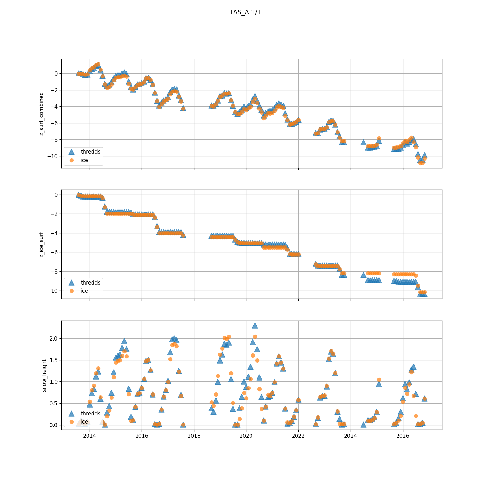
 
## TAS_L
Variables in new file:
p_u, t_u, rh_u, rh_u_wrt_ice_or_water, qh_u, wspd_u, wdir_u, wspd_x_u, wspd_y_u, dsr, dsr_cor, usr, usr_cor, albedo, dlr, ulr, cc, t_surf, dlhf_u, dshf_u, z_boom_u, z_boom_cor_u, z_stake, z_stake_cor, z_pt, z_pt_cor, z_surf_combined, z_ice_surf, snow_height, t_i_1, t_i_2, t_i_3, t_i_4, t_i_5, t_i_6, t_i_7, t_i_8, d_t_i_1, d_t_i_2, d_t_i_3, d_t_i_4, d_t_i_5, d_t_i_6, d_t_i_7, d_t_i_8, t_i_10m, tilt_x, tilt_y, rot_true, gps_lat, gps_lon, gps_alt, lat, lon, alt, batt_v, t_rad

New variables not in old files:

Old variables removed from new files:

 
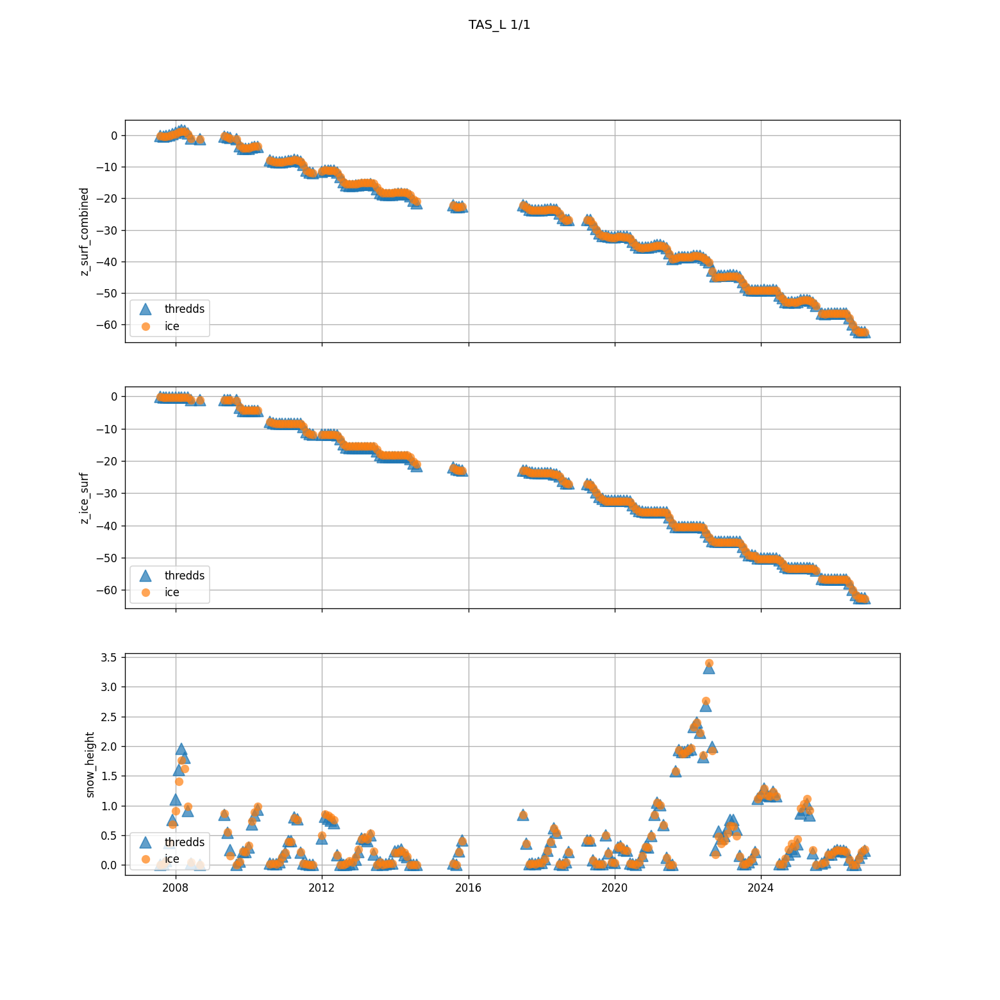
 
## TAS_U
Variables in new file:
p_u, t_u, rh_u, rh_u_wrt_ice_or_water, qh_u, wspd_u, wdir_u, wspd_x_u, wspd_y_u, dsr, dsr_cor, usr, usr_cor, albedo, dlr, ulr, cc, t_surf, dlhf_u, dshf_u, z_boom_u, z_boom_cor_u, z_stake, z_stake_cor, z_pt, z_pt_cor, z_surf_combined, z_ice_surf, snow_height, t_i_1, t_i_2, t_i_3, t_i_4, t_i_5, t_i_6, t_i_7, t_i_8, d_t_i_1, d_t_i_2, d_t_i_3, d_t_i_4, d_t_i_5, d_t_i_6, d_t_i_7, d_t_i_8, t_i_10m, tilt_x, tilt_y, rot_true, gps_lat, gps_lon, gps_alt, lat, lon, alt, batt_v, t_rad

New variables not in old files:

Old variables removed from new files:

 
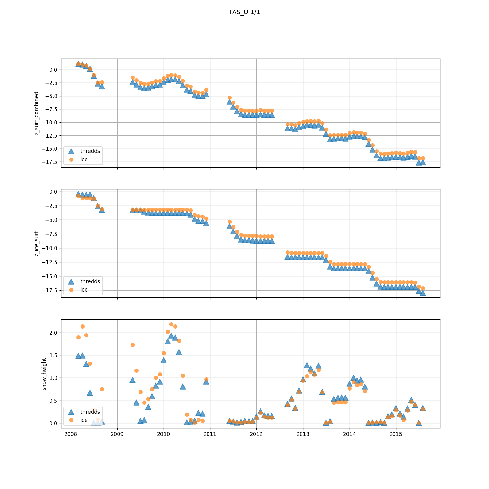
 
## THU_L
Variables in new file:
p_u, t_u, rh_u, rh_u_wrt_ice_or_water, qh_u, wspd_u, wdir_u, wspd_x_u, wspd_y_u, dsr, dsr_cor, usr, usr_cor, albedo, dlr, ulr, cc, t_surf, dlhf_u, dshf_u, z_boom_u, z_boom_cor_u, z_stake, z_stake_cor, z_pt, z_pt_cor, z_surf_combined, z_ice_surf, snow_height, t_i_1, t_i_2, t_i_3, t_i_4, t_i_5, t_i_6, t_i_7, t_i_8, d_t_i_1, d_t_i_2, d_t_i_3, d_t_i_4, d_t_i_5, d_t_i_6, d_t_i_7, d_t_i_8, t_i_10m, tilt_x, tilt_y, rot_true, gps_lat, gps_lon, gps_alt, lat, lon, alt, batt_v, t_rad

New variables not in old files:

Old variables removed from new files:

 
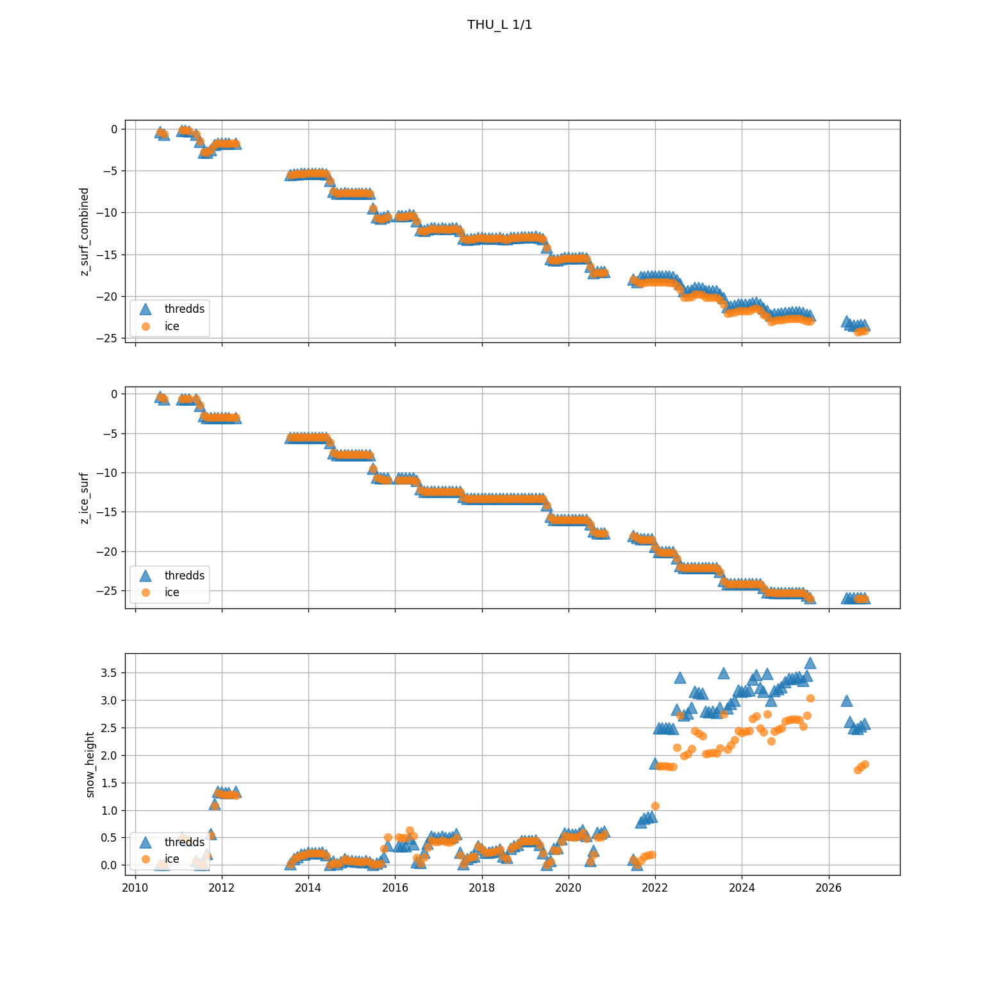
 
## THU_L2
Variables in new file:
p_u, t_u, rh_u, rh_u_wrt_ice_or_water, qh_u, wspd_u, wdir_u, wspd_x_u, wspd_y_u, dsr, dsr_cor, usr, usr_cor, albedo, dlr, ulr, cc, t_surf, dlhf_u, dshf_u, z_boom_u, z_boom_cor_u, z_stake, z_stake_cor, z_pt, z_pt_cor, z_surf_combined, z_ice_surf, snow_height, t_i_1, t_i_2, t_i_3, t_i_4, t_i_5, t_i_6, t_i_7, t_i_8, d_t_i_1, d_t_i_2, d_t_i_3, d_t_i_4, d_t_i_5, d_t_i_6, d_t_i_7, d_t_i_8, t_i_10m, tilt_x, tilt_y, rot_true, gps_lat, gps_lon, gps_alt, lat, lon, alt, batt_v, t_rad

New variables not in old files:

Old variables removed from new files:

 
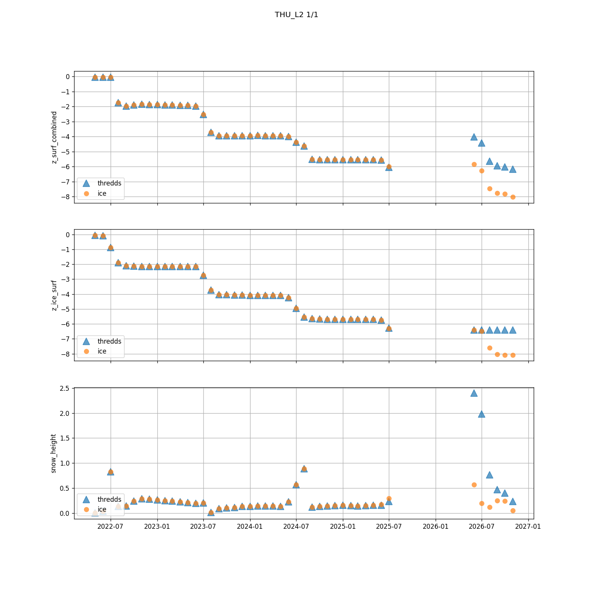
 
## THU_U
Variables in new file:
p_u, t_u, rh_u, rh_u_wrt_ice_or_water, qh_u, wspd_u, wdir_u, wspd_x_u, wspd_y_u, dsr, dsr_cor, usr, usr_cor, albedo, dlr, ulr, cc, t_surf, dlhf_u, dshf_u, z_boom_u, z_boom_cor_u, z_stake, z_stake_cor, z_pt, z_pt_cor, z_surf_combined, z_ice_surf, snow_height, rainfall_u, rainfall_cor_u, t_i_1, t_i_2, t_i_3, t_i_4, t_i_5, t_i_6, t_i_7, t_i_8, d_t_i_1, d_t_i_2, d_t_i_3, d_t_i_4, d_t_i_5, d_t_i_6, d_t_i_7, d_t_i_8, t_i_10m, tilt_x, tilt_y, rot_magnetic, rot_true, gps_lat, gps_lon, gps_alt, lat, lon, alt, batt_v, t_rad

New variables not in old files:

Old variables removed from new files:

 
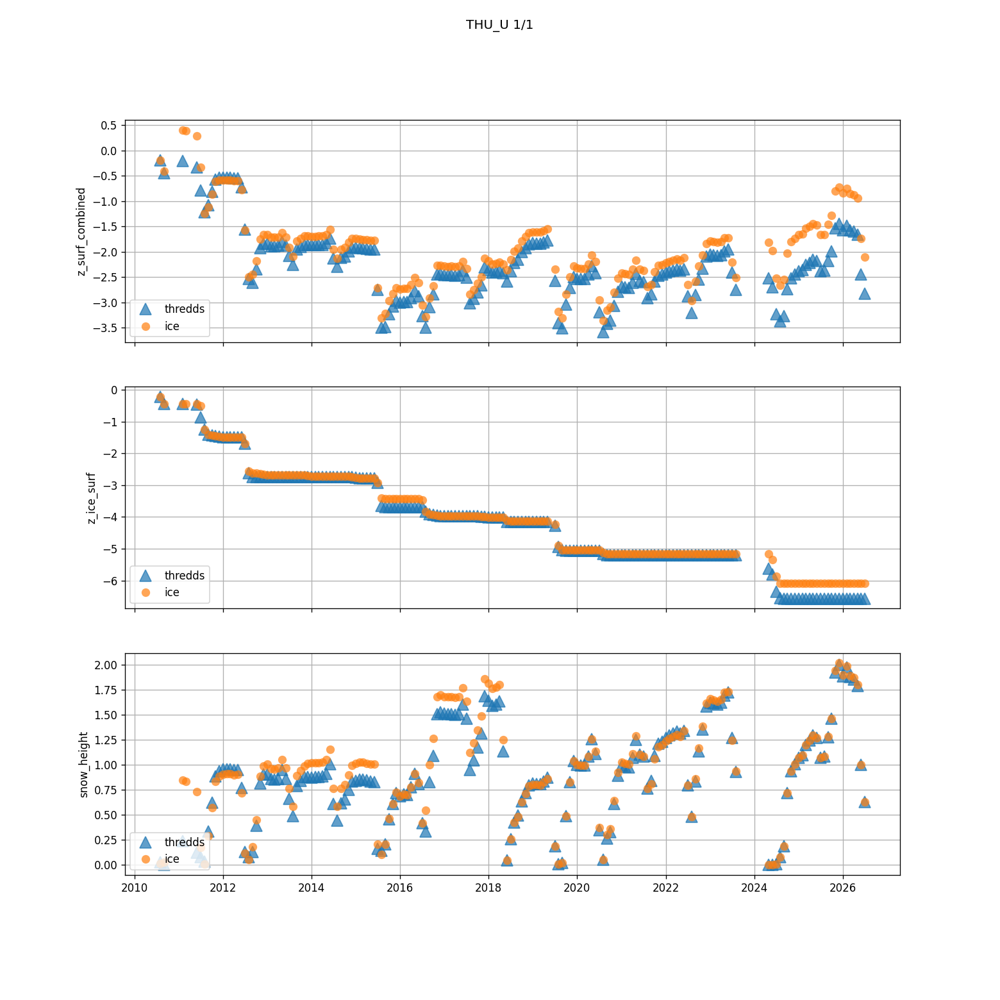
 
## TUN
Variables in new file:
p_u, p_l, t_u, t_l, rh_u, rh_u_wrt_ice_or_water, qh_u, rh_l, rh_l_wrt_ice_or_water, qh_l, wspd_u, wspd_l, wdir_u, wdir_l, wspd_x_u, wspd_y_u, wspd_x_l, wspd_y_l, dsr, dsr_cor, usr, usr_cor, albedo, dlr, ulr, cc, t_surf, dlhf_u, dlhf_l, dshf_u, dshf_l, z_boom_u, z_boom_cor_u, z_boom_l, z_boom_cor_l, z_surf_combined, snow_height, rainfall_u, rainfall_cor_u, rainfall_l, rainfall_cor_l, t_i_1, t_i_2, t_i_3, t_i_4, t_i_5, t_i_6, t_i_7, t_i_8, t_i_9, t_i_10, t_i_11, d_t_i_1, d_t_i_2, d_t_i_3, d_t_i_4, d_t_i_5, d_t_i_6, d_t_i_7, d_t_i_8, d_t_i_9, d_t_i_10, d_t_i_11, t_i_10m, tilt_x, tilt_y, rot_magnetic, rot_true, gps_lat, gps_lon, gps_alt, lat, lon, alt, batt_v, t_rad

New variables not in old files:

Old variables removed from new files:

 
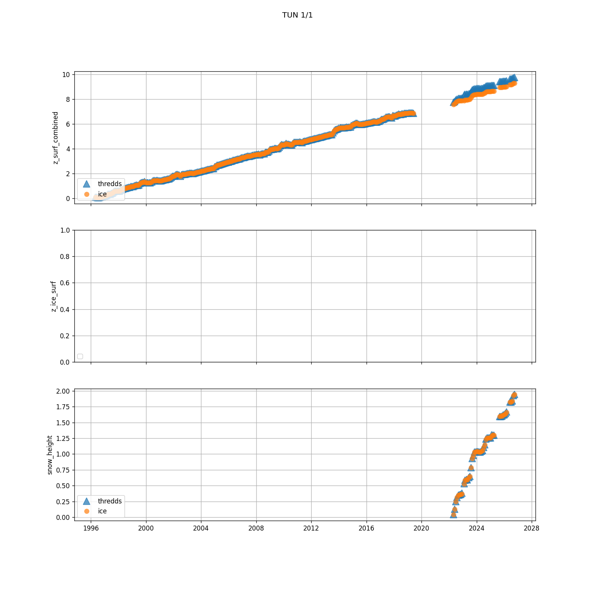
 
## UPE_L
Variables in new file:
p_u, t_u, rh_u, rh_u_wrt_ice_or_water, qh_u, wspd_u, wdir_u, wspd_x_u, wspd_y_u, dsr, dsr_cor, usr, usr_cor, albedo, dlr, ulr, cc, t_surf, dlhf_u, dshf_u, z_boom_u, z_boom_cor_u, z_stake, z_stake_cor, z_pt, z_pt_cor, z_surf_combined, z_ice_surf, snow_height, t_i_1, t_i_2, t_i_3, t_i_4, t_i_5, t_i_6, t_i_7, t_i_8, d_t_i_1, d_t_i_2, d_t_i_3, d_t_i_4, d_t_i_5, d_t_i_6, d_t_i_7, d_t_i_8, t_i_10m, tilt_x, tilt_y, rot_true, gps_lat, gps_lon, gps_alt, lat, lon, alt, batt_v, t_rad

New variables not in old files:

Old variables removed from new files:

 
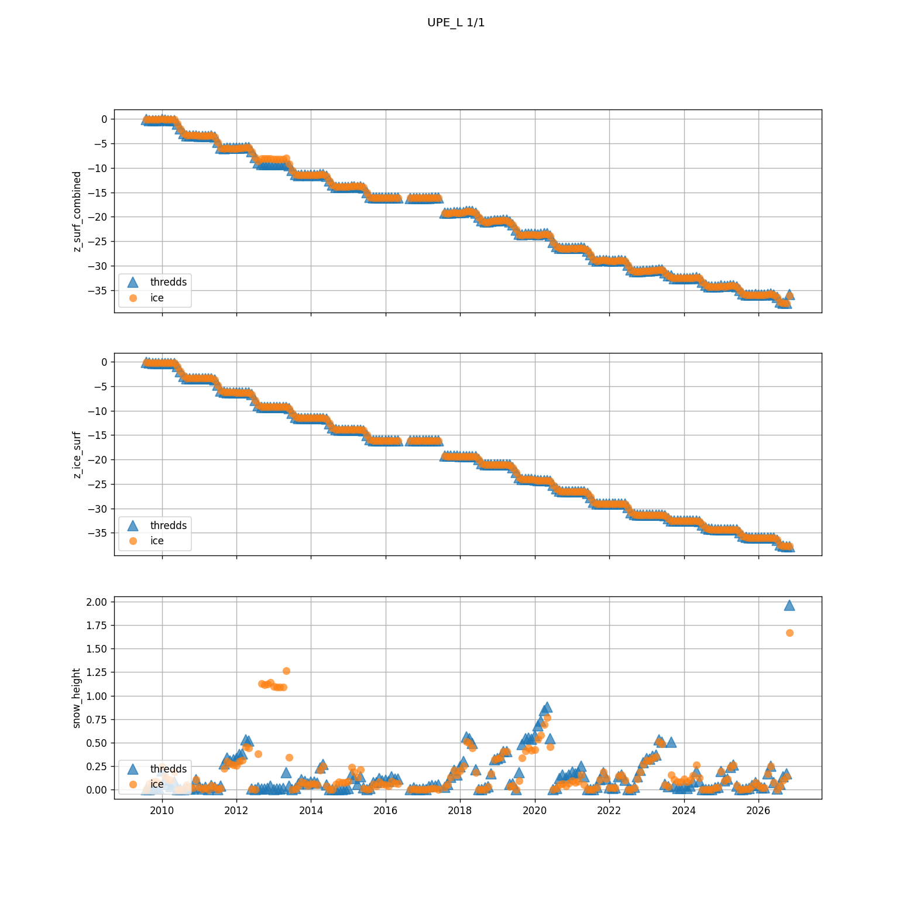
 
## UPE_U
Variables in new file:
p_u, t_u, rh_u, rh_u_wrt_ice_or_water, qh_u, wspd_u, wdir_u, wspd_x_u, wspd_y_u, dsr, dsr_cor, usr, usr_cor, albedo, dlr, ulr, cc, t_surf, dlhf_u, dshf_u, z_boom_u, z_boom_cor_u, z_stake, z_stake_cor, z_pt, z_pt_cor, z_surf_combined, z_ice_surf, snow_height, t_i_1, t_i_2, t_i_3, t_i_4, t_i_5, t_i_6, t_i_7, t_i_8, d_t_i_1, d_t_i_2, d_t_i_3, d_t_i_4, d_t_i_5, d_t_i_6, d_t_i_7, d_t_i_8, t_i_10m, tilt_x, tilt_y, rot_true, gps_lat, gps_lon, gps_alt, lat, lon, alt, batt_v, t_rad

New variables not in old files:

Old variables removed from new files:

 
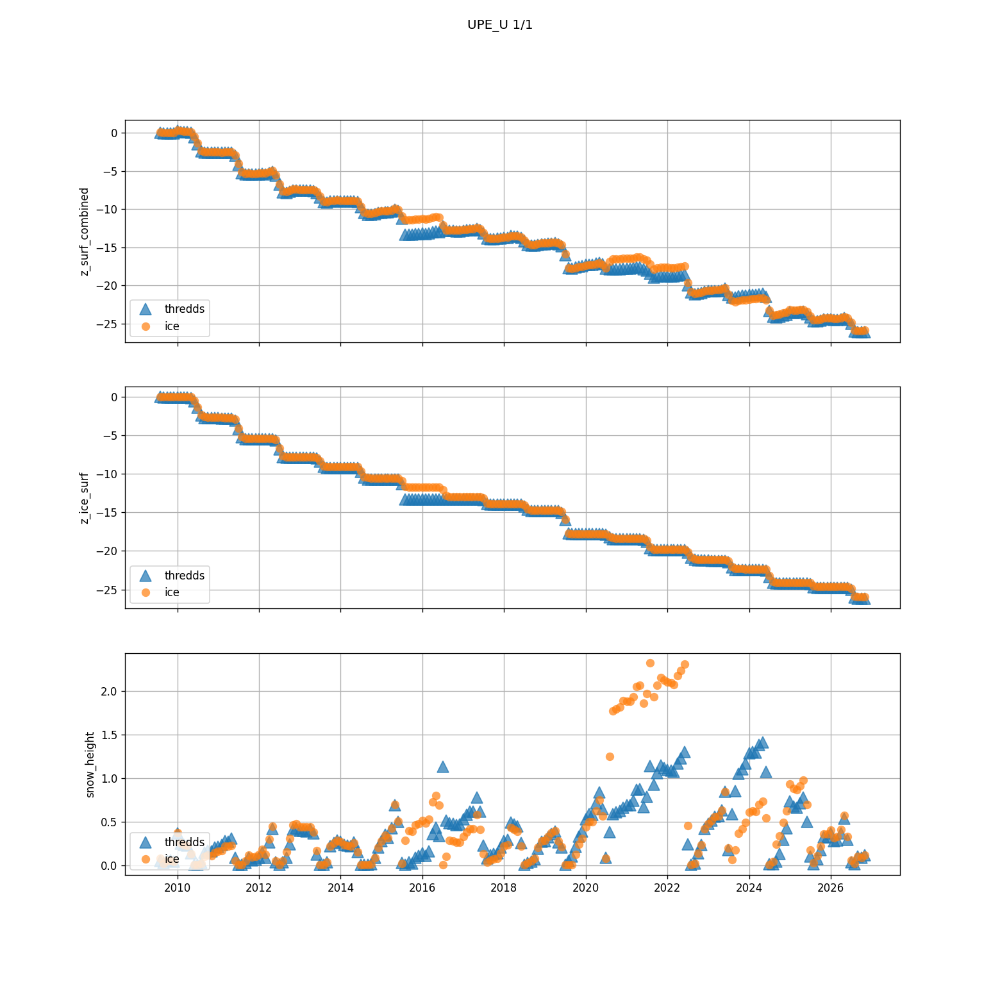
 
## UWN
## WEG_B
Variables in new file:
p_u, t_u, rh_u, rh_u_wrt_ice_or_water, qh_u, wspd_u, wdir_u, wspd_x_u, wspd_y_u, dsr, usr, albedo, dlr, ulr, t_surf, z_boom_u, z_boom_cor_u, z_surf_combined, snow_height, rainfall_u, rainfall_cor_u, tilt_x, tilt_y, rot_magnetic, rot_true, gps_lat, gps_lon, gps_alt, lat, lon, alt, batt_v, t_rad

New variables not in old files:

Old variables removed from new files:

 
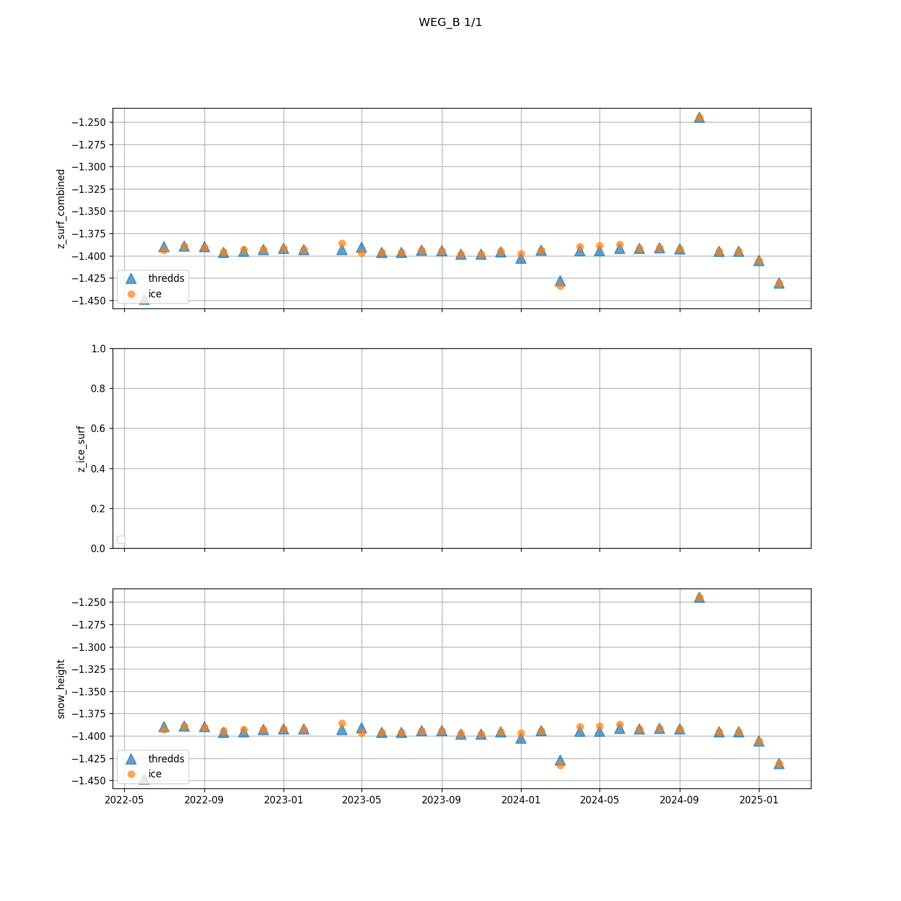
 
## WEG_L
Variables in new file:
p_u, t_u, rh_u, rh_u_wrt_ice_or_water, qh_u, wspd_u, wdir_u, wspd_x_u, wspd_y_u, dsr, dsr_cor, usr, usr_cor, albedo, dlr, ulr, cc, t_surf, dlhf_u, dshf_u, z_boom_u, z_boom_cor_u, z_stake, z_stake_cor, z_pt, z_pt_cor, z_surf_combined, z_ice_surf, snow_height, rainfall_u, rainfall_cor_u, t_i_1, t_i_2, t_i_3, t_i_4, t_i_5, t_i_6, t_i_7, t_i_8, d_t_i_1, d_t_i_2, d_t_i_3, d_t_i_4, d_t_i_5, d_t_i_6, d_t_i_7, d_t_i_8, tilt_x, tilt_y, rot_magnetic, rot_true, gps_lat, gps_lon, gps_alt, lat, lon, alt, batt_v, t_rad

New variables not in old files:

Old variables removed from new files:

 
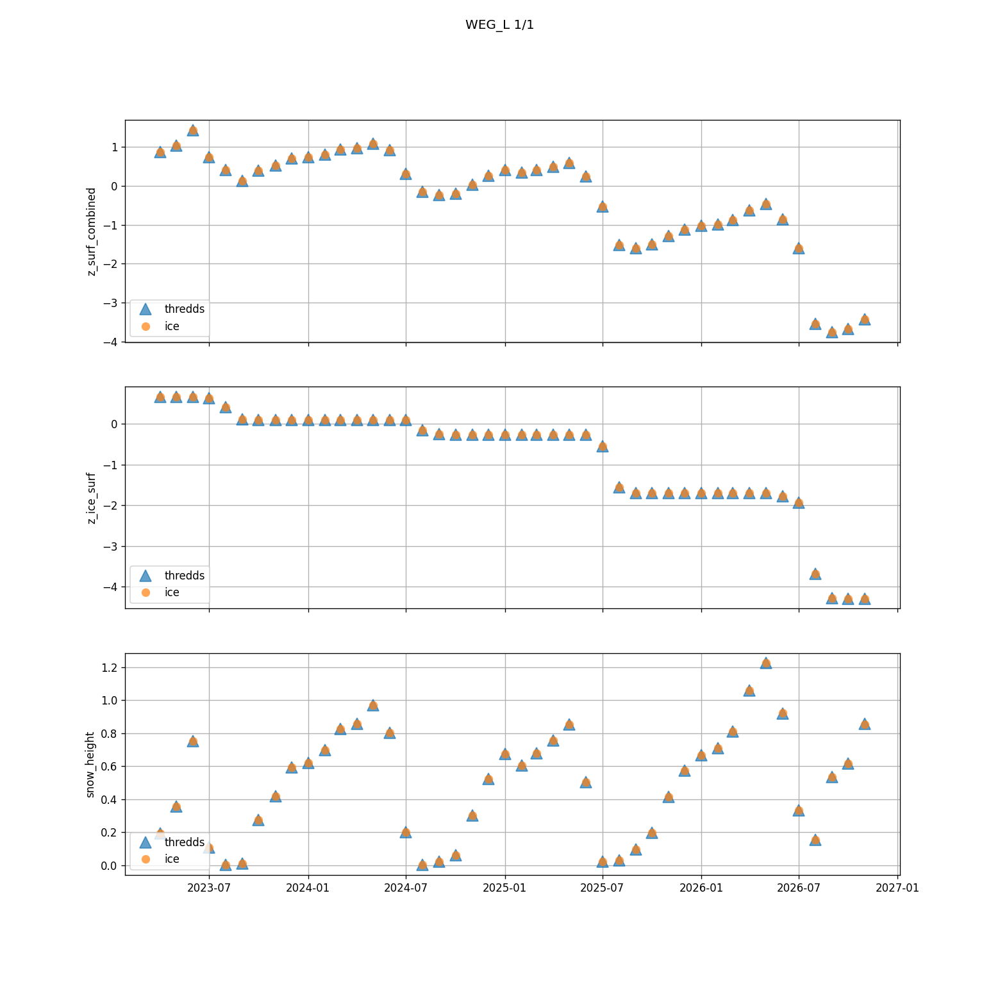
 
## ZAC_A
Variables in new file:
p_u, p_l, t_u, t_l, rh_u, rh_u_wrt_ice_or_water, qh_u, rh_l, rh_l_wrt_ice_or_water, qh_l, wspd_u, wspd_l, wdir_u, wdir_l, wspd_x_u, wspd_y_u, wspd_x_l, wspd_y_l, dsr, dsr_cor, usr, usr_cor, albedo, dlr, ulr, cc, t_surf, dlhf_u, dlhf_l, dshf_u, dshf_l, z_boom_u, z_boom_cor_u, z_boom_l, z_boom_cor_l, z_stake, z_pt_cor, z_surf_combined, snow_height, rainfall_u, rainfall_cor_u, rainfall_l, rainfall_cor_l, t_i_1, t_i_2, t_i_3, t_i_4, t_i_5, t_i_6, t_i_7, t_i_8, t_i_9, t_i_10, t_i_11, d_t_i_1, d_t_i_2, d_t_i_3, d_t_i_4, d_t_i_5, d_t_i_6, d_t_i_7, d_t_i_8, d_t_i_9, d_t_i_10, d_t_i_11, t_i_10m, tilt_x, tilt_y, rot_magnetic, rot_true, gps_lat, gps_lon, gps_alt, lat, lon, alt, batt_v, t_rad

New variables not in old files:
z_pt_cor

Old variables removed from new files:

 

 
## ZAC_L
Variables in new file:
p_u, t_u, rh_u, rh_u_wrt_ice_or_water, qh_u, wspd_u, wdir_u, wspd_x_u, wspd_y_u, dsr, dsr_cor, usr, usr_cor, albedo, dlr, ulr, cc, t_surf, dlhf_u, dshf_u, z_boom_u, z_boom_cor_u, z_stake, z_stake_cor, z_pt, z_pt_cor, z_surf_combined, z_ice_surf, snow_height, rainfall_u, rainfall_cor_u, t_i_1, t_i_2, t_i_3, t_i_4, t_i_5, t_i_6, t_i_7, t_i_8, d_t_i_1, d_t_i_2, d_t_i_3, d_t_i_4, d_t_i_5, d_t_i_6, d_t_i_7, d_t_i_8, t_i_10m, tilt_x, tilt_y, rot_magnetic, rot_true, gps_lat, gps_lon, gps_alt, lat, lon, alt, batt_v, t_rad

New variables not in old files:

Old variables removed from new files:

 

 
## ZAC_U
Variables in new file:
p_u, t_u, rh_u, rh_u_wrt_ice_or_water, qh_u, wspd_u, wdir_u, wspd_x_u, wspd_y_u, dsr, dsr_cor, usr, usr_cor, albedo, dlr, ulr, cc, t_surf, dlhf_u, dshf_u, z_boom_u, z_boom_cor_u, z_stake, z_stake_cor, z_pt, z_pt_cor, z_surf_combined, z_ice_surf, snow_height, rainfall_u, rainfall_cor_u, t_i_1, t_i_2, t_i_3, t_i_4, t_i_5, t_i_6, t_i_7, t_i_8, d_t_i_1, d_t_i_2, d_t_i_3, d_t_i_4, d_t_i_5, d_t_i_6, d_t_i_7, d_t_i_8, t_i_10m, tilt_x, tilt_y, rot_magnetic, rot_true, gps_lat, gps_lon, gps_alt, lat, lon, alt, batt_v, t_rad

New variables not in old files:

Old variables removed from new files:

 

 
