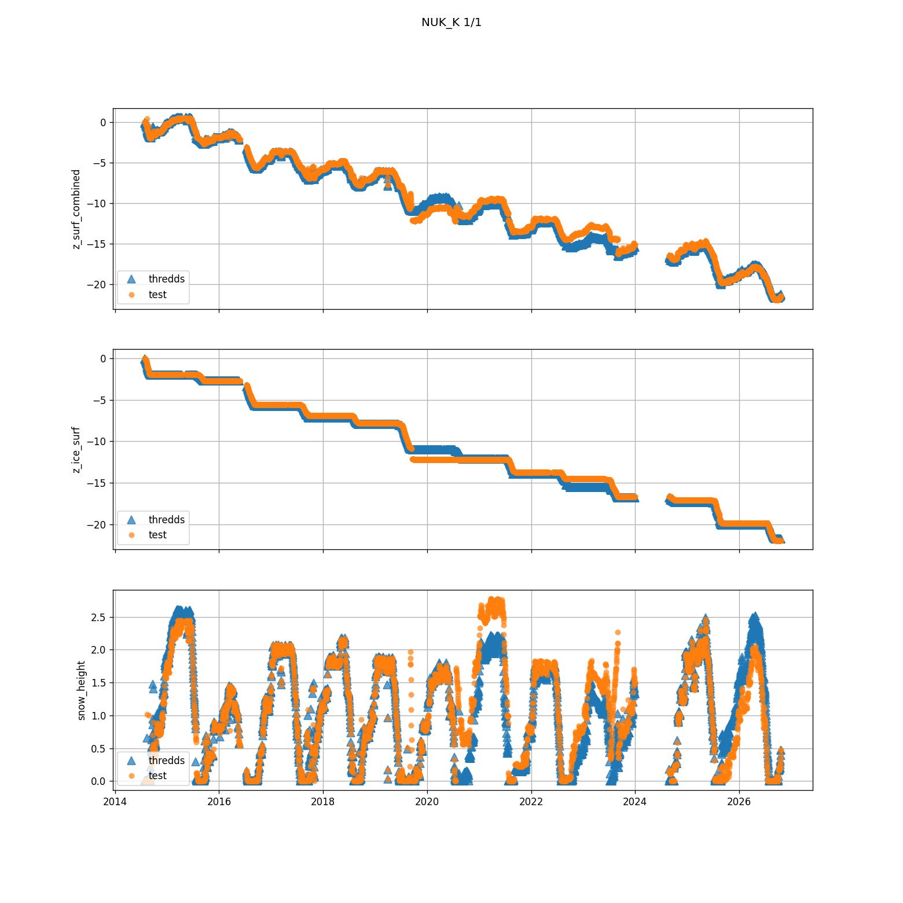

* [Comparison of data test to thredds (old).](#s1)
  * [NUK_K](#s1-1)
# <a id='s1' />Comparison of data test to thredds (old).
## <a id='s1-1' />NUK_K
Variables in new file:
p_u, t_u, rh_u, rh_u_wrt_ice_or_water, qh_u, wspd_u, wdir_u, wspd_x_u, wspd_y_u, dsr, dsr_cor, usr, usr_cor, albedo, dlr, ulr, cc, t_surf, dlhf_u, dshf_u, z_boom_u, z_boom_cor_u, z_stake, z_stake_cor, z_pt, z_pt_cor, z_surf_combined, z_ice_surf, snow_height, rainfall_u, rainfall_cor_u, t_i_1, t_i_2, t_i_3, t_i_4, t_i_5, t_i_6, t_i_7, t_i_8, d_t_i_1, d_t_i_2, d_t_i_3, d_t_i_4, d_t_i_5, d_t_i_6, d_t_i_7, d_t_i_8, t_i_10m, tilt_x, tilt_y, rot_magnetic, rot_true, gps_lat, gps_lon, gps_alt, lat, lon, alt, batt_v, t_rad

New variables not in old files:

Old variables removed from new files:

 

 
